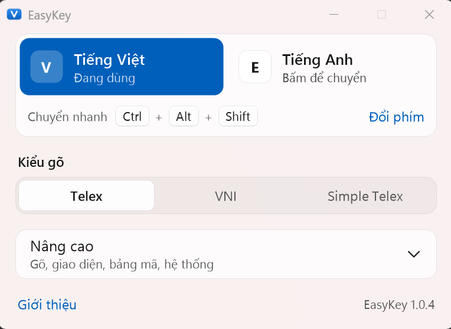
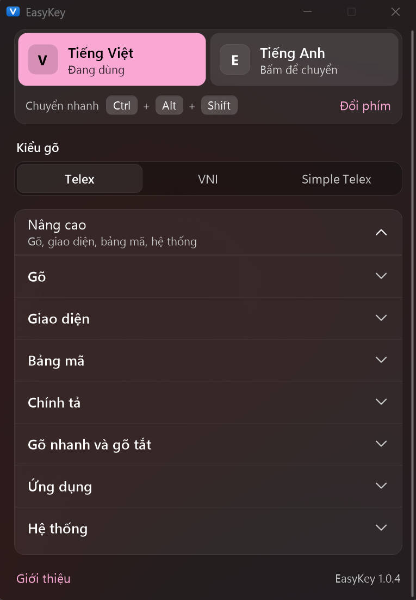

# EasyKey

[Tiếng Việt](README.md) · **English**

A lightweight Vietnamese keyboard for Windows 11: one `EasyKey.exe` under 1 MB, nothing to install, with a Windows 11 style look.

[**Download the latest version**](https://github.com/iamcino/EasyKey/releases/latest) · [Changelog](CHANGELOG.en.md) · [Report a bug](https://github.com/iamcino/EasyKey/issues)

<p align="center">
  
  
</p>
<p align="center">
  
</p>

## Requirements
- Windows 11, 64-bit (x64).
- No admin rights, .NET or extra runtimes needed.
- Quit other Vietnamese keyboards (UniKey, EVKey, OpenKey...). EasyKey tells you if it finds one running.

## Highlights
- **Telex, VNI, Simple Telex**, Unicode character encoding (legacy TCVN3, VNI Windows and Unicode combining under Advanced).
- **Smart typing:** marks only real Vietnamese words, and Esc gives back the keys you typed (việt → vieejt). Quick typing and shortcuts of any length.
- **Remembers Vietnamese/English and the character encoding per app.**
- **No repeated letters** in the Chrome and Edge address bar or other autocomplete fields.
- **Windows 11 look:** light/dark, accent colors, Vietnamese or English UI, a small popup when you switch between Vietnamese and English.
- **No ENG/VIE language indicator** on the taskbar.
- **Updates itself** from inside the app (always asks first, checks the SHA-256) and removes itself cleanly with one button.

## Install
1. Download `EasyKey<version>-Windows.zip` from the [Releases](https://github.com/iamcino/EasyKey/releases/latest) page.
2. Unzip it into a folder you will keep and run `EasyKey.exe`.
3. Done. The defaults are Telex, Unicode, start with Windows, and **Alt + Z** to switch between Vietnamese and English.

If OpenKey is installed, EasyKey copies its settings and shortcut list on the first run.

## Windows warnings
EasyKey is **not code signed** yet, so SmartScreen may show "Windows protected your PC" (click **More info** › **Run anyway**), and antivirus software may block `EasyKey.exe`. Every keyboard app has to read keystrokes, so unsigned ones are easily suspected.

<details>
<summary>Verify your download</summary>

The source code is public, and every release is built on GitHub Actions with build provenance. Check it with the [GitHub CLI](https://cli.github.com):

```
gh attestation verify EasyKey<version>-Windows.zip --repo iamcino/EasyKey
```

If you trust it, you can add the EasyKey folder to your antivirus exclusions. Later versions will be signed once a certificate is available.
</details>

<details>
<summary>Red spell check underlines under Vietnamese</summary>

They come from each app's own spell checker, which checks against English. They are not an EasyKey bug:

- **Chrome, Edge, Cốc Cốc:** Settings › Languages, add Vietnamese and turn on spell check for it, or turn off spell check for English.
- **Word, Outlook, PowerPoint:** select the text, Review › Language › Set Proofing Language › Vietnamese (or tick "Do not check spelling or grammar").
- **Notepad:** Settings (gear icon) › turn off Spell check.

Adding Vietnamese in Windows Settings › Language also removes them, but brings back the ENG/VIE indicator on the taskbar, so it is not recommended.
</details>

## Build it yourself
See [docs/BUILD.en.md](docs/BUILD.en.md).

## License
Copyright (C) 2026 Cino. Contact: duongtheson@proton.me

EasyKey is released under the [GNU GPL version 3](LICENSE) and is based on [OpenKey](https://github.com/tuyenvm/OpenKey) by Mai Vũ Tuyên (Copyright (C) 2019, GPLv3). Some files written from scratch for EasyKey are also offered under the [MIT license](LICENSES/MIT.txt). See [NOTICE](NOTICE) for details.
