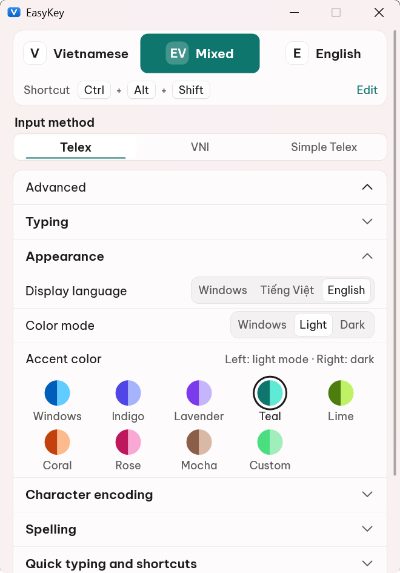
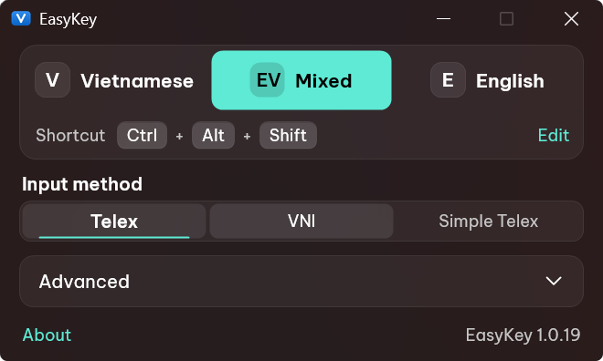

# EasyKey

**Vietnamese typing for Windows 11, so light you forget it's there.** 
One file under 1 MB, English and Vietnamese in the same sentence without switching, and no keyboard trouble in games.

[Tiếng Việt](README.md) · **English**

### ⬇ Download EasyKey.exe: [from GitHub](https://github.com/iamcino/EasyKey/releases/latest/download/EasyKey.exe) · [from GitLab](https://gitlab.com/cino-group/easykey/-/releases/permalink/latest/downloads/EasyKey.exe)

Releases: [GitHub](https://github.com/iamcino/EasyKey/releases/latest) · [GitLab](https://gitlab.com/cino-group/easykey/-/releases) · [What's new](CHANGELOG.en.md) · [Report a bug](https://github.com/iamcino/EasyKey/issues)

---

## Up and running in a minute

1. **Download** `EasyKey.exe` [from GitHub](https://github.com/iamcino/EasyKey/releases/latest/download/EasyKey.exe) or [from GitLab](https://gitlab.com/cino-group/easykey/-/releases/permalink/latest/downloads/EasyKey.exe) and open it. There is no installer and no administrator prompt.
2. **Start typing** anywhere. The defaults are Telex and Unicode.
3. **Press Alt + Z** to cycle through Vietnamese, Mixed and English.

That's it. EasyKey lives in the notification area (bottom right of the
taskbar): double-click its icon for Settings, right-click for the menu. If
Windows shows a warning when you open the file, see
[Windows warnings](#windows-warnings).

> The first time you run it from Downloads, EasyKey offers to move itself to
> `%LOCALAPPDATA%\Programs\EasyKey` so cleaning up that folder doesn't break it.
> Coming from OpenKey? EasyKey copies your settings and shortcut list over.

## Why EasyKey

| | |
|---|---|
| 🪶 **Tiny and tidy** | Just one `EasyKey.exe`. No installer, no DLLs, no .NET. Put it on a USB stick and it still runs. |
| 🔀 **Mix English and Vietnamese freely** | Mixed mode spots English words and gives you back the exact keys you typed, even tricky ones like "test" (tét) or "this" (thí). No more switching mid-sentence. |
| 🎮 **Games just work** | Turn on game mode and WASD or QWER go straight to the game. Press Enter to chat in Vietnamese, Esc to get back to the action. |
| 🧠 **Remembers each app** | Every app keeps its own mode and character encoding. Code in VS Code, switch to your chat app, and it's still Vietnamese there. |
| 🔒 **Truly private** | No account, no ads, no data collection, no key logging. Password fields always get plain keys. |
| ✨ **Made for Windows 11** | Mica, light/dark following Windows, your choice of accent color, crisp text at any scale. No ENG/VIE box on the taskbar. |
| 🛡️ **Safe updates** | Tells you when a new version is out, always asks first, and only installs files signed by EasyKey. |

## Features

### Vietnamese typing

- **Telex, VNI and Simple Telex.** Switch in Settings, the tray menu, or with a hotkey if you turn one on.
- **Smart typing:** adds marks only when the word is valid Vietnamese. Got a wrong mark? Press **Esc** right after the word to get your keys back (việt → vieejt).
- **Modern marks** (hoà, thuý) or classic ones (hòa, thúy), your call.
- **Shortcuts** of any length, with a few common ones built in: ko → không, dc → được, vs → với, mn → mọi người, ntn → như thế nào. Shortcuts follow the capitalization you type.
- **Quick typing** (optional): cc → ch, gg → gi, nn → ng; f → ph, j → gi, w → qu at the start of a word; g → ng, h → nh, k → ch at the end.
- **Capitalizes the first letter of sentences**, including after ? and !.
- **Convert tool** between character encodings, upper/lower case and unmarked text, with a hotkey to convert the clipboard in one go.
- **Legacy encodings** (Unicode combining, TCVN3, VNI Windows) are still there under Advanced › Character encoding for old fonts.

### Mixed English and Vietnamese mode

Made for people who write in both languages: developers, office work, study, chat.

Type Vietnamese as usual. Each time you finish a word, EasyKey decides whether
it was English or Vietnamese, based on how common the word is in each language
and the words around it. If it was English, the marked text is replaced by the
exact keys you typed.

- "tôi sẽ đi" stays Vietnamese, while "There are" doesn't become "Thể are".
- "chạy test" keeps "test", but "bánh tét" still comes out as "tét".
- Variable names, email addresses, `snake_case` and `camelCase` are left alone.
- Wrong guess? Press **Esc** right after the word.

**Alt + Z** or clicking the tray icon cycles Vietnamese → Mixed → English.
Prefer just two modes? Turn on **Only 2 modes (English and Vietnamese)** under
Advanced › Typing.

### Game mode

Vietnamese keyboards and games don't usually get along: W turns into "ư", "gg"
into "gi". Game mode fixes that.

1. Start your game, then right-click the tray icon › **Game mode**.
2. Pick the game from the suggestions (EasyKey finds running games for you), or
   use **Browse .exe file…** to choose the game's file.

From then on, whenever you're in that game:

- Control keys go straight to the game, never through the keyboard engine.
- Press **Enter** to open chat and type Vietnamese as usual. **Esc**, **Enter**
  or a mouse click takes you back to the game.
- Commands starting with `/`, like `/all` or `/ff`, are left untouched.
- Alt+Tab out and back and game mode is still on; other apps aren't affected.

If the game runs as administrator, turn on **Run as administrator** for
EasyKey (Advanced › System). A few games ignore simulated keys; switch to
English for chat in those.

### Per app

- **Remembers the mode and character encoding for each app.** Switch windows
  and EasyKey follows, Microsoft Store apps included.
- **Password fields get plain keys**: no marks, no shortcuts, in Windows apps
  as well as Chrome, Edge and Firefox. EasyKey never reads what's in the field.
- **No doubled letters** in the Chrome, Edge and Brave address bars or other
  fields with autocomplete.
- **Apps running as administrator** (Task Manager, installers…): EasyKey lets
  you know, and can run elevated too without a UAC prompt at every sign-in.
- **Send text through the clipboard** for the rare app that mangles marks.

### Interface

- The main screen shows only what you use often: mode, switch hotkey, input
  method. Everything else is tucked under **Advanced**, each row with a
  one-line explanation.
- Light, dark or follow Windows. Accent color from Windows, 7 presets or your
  own.
- Vietnamese or English interface.
- A small popup when you switch modes (hidden while you play full screen), plus
  an optional beep.
- The tray icon tells you what you're typing: **V** for Vietnamese, **EV** for
  Mixed, **E** for English. A green arrow means an update is ready.

  
  &nbsp;
  

### Keeps working

- **Reconnects itself** when Windows drops the keyboard hook (the familiar "chaats" bug in Discord).
- **Warns you** when UniKey, EVKey, OpenKey… run at the same time, since two keyboards add marks twice.

## Quick tips

| To… | Do this |
|---|---|
| Cycle Vietnamese → Mixed → English | **Alt + Z**, or click the tray icon |
| Open Settings | Double-click the tray icon |
| Undo a wrong mark | **Esc** right after the word |
| Change input method or encoding | Right-click the tray icon › Input method / Character encoding |
| Turn on game mode | Right-click the tray icon › Game mode |
| Change the switch hotkey | Settings › Shortcut › Edit |
| Add a shortcut | Right-click the tray icon › Shortcut list… |

## Updates

EasyKey checks for a new version at start and every 6 hours. When one is out,
the tray icon shows a green arrow and the tray menu offers **Update to …**.
Nothing is installed until you say so. When you do, EasyKey downloads the new
version from the project's release page, checks its SHA-256 hash and digital
signature, and restarts itself.

To check right away: right-click the tray icon › **Check for updates…**. To
stop automatic checks: Advanced › System.

## FAQ

**Which Windows do I need?**
Windows 11, 64-bit. No administrator rights, .NET or Visual C++ Redistributable needed.

**Do I need to uninstall UniKey or EVKey?**
No, just turn them off while you use EasyKey.

**Does EasyKey send what I type anywhere?**
No. Keys are handled on your computer only and are never written anywhere. The
only connection EasyKey makes on its own is the update check on GitHub. See
the [privacy policy](PRIVACY.md#english).

**How is EasyKey different from OpenKey?**
EasyKey keeps OpenKey's typing engine and rewrites almost everything else: the
interface, mixed mode, game mode, self-update, and many fixes for browsers and
modern apps.

**Why both GitHub and GitLab?**
Every release is published in both places, with the same signed files. If one of them is unreachable, download from the other. The source code is on both [GitHub](https://github.com/iamcino/EasyKey) and [GitLab](https://gitlab.com/cino-group/easykey) too.

**Is there a macOS, Linux or ARM version?**
Not yet. EasyKey is focused on getting Windows 11 x64 right first.

**How do I uninstall it?**
Settings › Advanced › System › **Remove EasyKey from Windows**. EasyKey removes
its startup entry, shortcut and all its settings, then quits. Then just delete
`EasyKey.exe`.

## Troubleshooting

### Windows warnings

EasyKey releases are digitally signed, but with the project's own certificate
rather than a commercial one. So the first time you open it, Windows may show
"Windows protected your PC" or "Unknown publisher". Click **More info** ›
**Run anyway**.

Some antivirus software may also raise a false alarm, because every
Vietnamese keyboard has to read key presses to add marks. To be sure your
download is genuine:

- **Download only** from the official release pages on [GitHub](https://github.com/iamcino/EasyKey/releases) or [GitLab](https://gitlab.com/cino-group/easykey/-/releases).
- **Check the signature:** open PowerShell in the file's folder and run
  `(Get-AuthenticodeSignature .\EasyKey.exe).SignerCertificate.Thumbprint`.
  It must print `073FF7FEF09B3E51C8863CA5B2168A79D396976A`.
- **See the virus scan:** each release includes `virustotal-<version>.json`
  with a link to its VirusTotal results.

More detail (SHA-256 hashes, build provenance) is in
[SECURITY.md](SECURITY.md#verifying-a-download).

### Vietnamese spell check

Red underlines under Vietnamese words come from the app checking spelling in
English, not from EasyKey. To fix it:

- **Chrome, Edge, Cốc Cốc:** Settings › Languages, add Vietnamese and turn on
  spell check for it, or turn off English spell check.
- **Word, Outlook, PowerPoint:** select the text, Review › Language › Set
  Proofing Language › Vietnamese (or tick "Do not check spelling or grammar").
- **Notepad:** Settings (gear) › turn off Spell check.

Adding Vietnamese in Windows Settings › Language also removes the underlines,
but brings back the ENG/VIE box on the taskbar, so it isn't recommended.

### Vietnamese doesn't work in one app

- **Apps running as administrator:** Windows doesn't let normal apps send keys
  to them. Turn on Advanced › System › **Run as administrator**.
- **Letters go missing or get doubled when marks are added:** try Advanced ›
  Apps › **Send text through the clipboard**. It replaces the clipboard every
  time a mark is added, so only turn it on when needed.
- **In games:** turn on [game mode](#game-mode).
- **Mixed mode guessed a word wrong:** press **Esc** right after it, then
  [tell us](https://github.com/iamcino/EasyKey/issues) the sentence you typed so
  EasyKey can guess better.

### Wrong text

If wrong text keeps happening (raw keys like "chaats", mixed-up capitals…), you
can turn on a key log to attach to a bug report:

1. Open PowerShell and run
   `reg add HKCU\Software\EasyKey /v vDebugKeyLog /t REG_DWORD /d 1 /f`.
2. Quit EasyKey (right-click the tray icon › Quit EasyKey) and start it again.
3. Type until the problem shows up. The log is at `%TEMP%\EasyKeyKeyLog.txt`.
4. Turn it off with `reg delete HKCU\Software\EasyKey /v vDebugKeyLog /f` and
   restart EasyKey.

The log records the keys you press, so don't type passwords while it's on, and
read it before you send it.

## For developers

EasyKey is written in C++ and Win32. It doesn't register a keyboard with
Windows; it uses a low-level keyboard hook, and when a mark is needed it
deletes the letters just typed and sends the marked ones. That's why there is
no ENG/VIE box on the taskbar.

- [Design document](docs/DESIGN.en.md): how a key travels, the engine, the interface, updates.
- [Build EasyKey yourself](docs/BUILD.en.md): with Visual Studio 2022, or on GitHub with nothing installed.
- [Contributing](CONTRIBUTING.md#english): bug reports and pull requests.

## License and credits

Copyright (C) 2026 Cino · duongtheson@proton.me

EasyKey is free, open-source software under the [GNU GPL version 3](LICENSE),
built on [OpenKey](https://github.com/tuyenvm/OpenKey) by Mai Vu Tuyen
(Copyright (C) 2019, GPLv3). Thank you to Tuyen for opening OpenKey to the
community. Some files written from scratch for EasyKey are also available
under the [MIT license](LICENSES/MIT.txt).

- Interface font **Be Vietnam Pro**: [SIL OFL 1.1](LICENSES/OFL-1.1.txt).
- The mixed mode word lists are based on [wordfreq](https://github.com/rspeer/wordfreq) data: CC BY-SA 4.0.

EasyKey is provided "as is", without warranty, and is an independent project
not affiliated with Microsoft or the OpenKey author. See the
[disclaimer](DISCLAIMER.md#english), [NOTICE](NOTICE) and the
[security policy](SECURITY.md#english).
