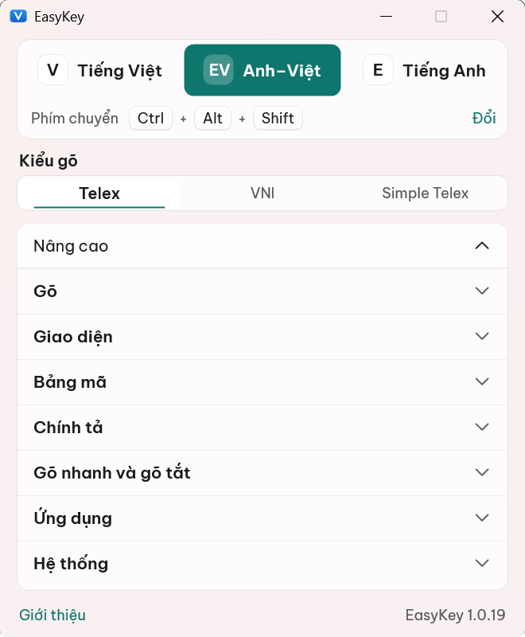
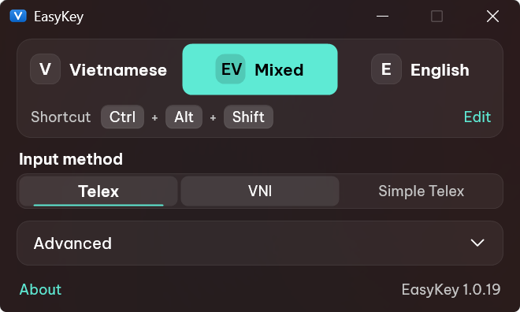

# EasyKey

**Gõ tiếng Việt trên Windows 11, nhẹ như không.** 
Một file chưa tới 1 MB, gõ lẫn tiếng Anh không cần chuyển chế độ, chơi game không lo bộ gõ.

**Tiếng Việt** · [English](README.en.md)

### [⬇ Tải EasyKey.exe](https://github.com/iamcino/EasyKey/releases/latest/download/EasyKey.exe)

[Trang phát hành](https://github.com/iamcino/EasyKey/releases/latest) · [Có gì mới](CHANGELOG.md) · [Báo lỗi](https://github.com/iamcino/EasyKey/issues)

---

## Bắt đầu trong một phút

1. **Tải** [`EasyKey.exe`](https://github.com/iamcino/EasyKey/releases/latest/download/EasyKey.exe) và mở nó. Không có trình cài đặt, không cần quyền Admin.
2. **Gõ thử** ở bất cứ đâu. Mặc định là Telex, bảng mã Unicode.
3. **Bấm Alt + Z** để đổi qua lại giữa Tiếng Việt, Anh–Việt và Tiếng Anh.

Vậy là xong. Biểu tượng EasyKey nằm ở khay hệ thống (góc phải thanh tác vụ):
bấm đúp để mở Cài đặt, bấm phải để xem menu. Nếu Windows hiện cảnh báo khi mở
file, xem [Cảnh báo của Windows](#cảnh-báo-của-windows).

> Mở lần đầu từ thư mục Tải về, EasyKey sẽ đề nghị chuyển sang
> `%LOCALAPPDATA%\Programs\EasyKey` để không bị mất khi bạn dọn thư mục. Đang
> dùng OpenKey? EasyKey tự chép cài đặt và bảng gõ tắt của bạn sang.

## Vì sao chọn EasyKey

| | |
|---|---|
| 🪶 **Nhẹ và gọn** | Chỉ một file `EasyKey.exe`. Không trình cài đặt, không DLL, không .NET. Bỏ vào USB mang đi cũng chạy. |
| 🔀 **Gõ Anh lẫn Việt thoải mái** | Chế độ Anh–Việt tự nhận ra từ tiếng Anh và trả lại đúng phím bạn gõ, kể cả từ dễ nhầm như "test" (tét) hay "this" (thí). Hết cảnh phải bấm chuyển giữa câu. |
| 🎮 **Chơi game không lo bộ gõ** | Bật chế độ game là phím WASD, QWER đi thẳng vào game. Bấm Enter để chat tiếng Việt, Esc là về trận. |
| 🧠 **Nhớ theo từng ứng dụng** | Mỗi ứng dụng giữ chế độ gõ và bảng mã riêng. Đang gõ code ở VS Code, chuyển sang Zalo vẫn là tiếng Việt. |
| 🔒 **Riêng tư thật sự** | Không tài khoản, không quảng cáo, không thu thập dữ liệu, không ghi lại phím. Ô mật khẩu tự gõ phím thô. |
| ✨ **Đẹp đúng chất Windows 11** | Nền Mica, sáng/tối theo Windows, chọn màu nhấn, chữ sắc nét ở mọi mức phóng to. Không có ô ENG/VIE chiếm chỗ trên thanh tác vụ. |
| 🛡️ **Cập nhật an toàn** | Báo khi có bản mới, luôn hỏi trước khi cài, và chỉ cài file mang chữ ký số của EasyKey. |

## Tính năng

### Gõ tiếng Việt

- **Telex, VNI và Simple Telex.** Đổi trong Cài đặt, menu khay, hoặc bằng phím tắt nếu bạn bật.
- **Gõ thông minh:** chỉ bỏ dấu khi từ đúng chính tả tiếng Việt. Bỏ dấu nhầm? Bấm **Esc** ngay sau từ đó để lấy lại phím vừa gõ (việt → vieejt).
- **Dấu kiểu mới** (hoà, thuý) hoặc kiểu cũ (hòa, thúy), tuỳ bạn.
- **Gõ tắt** không giới hạn độ dài, có sẵn vài từ quen thuộc: ko → không, dc → được, vs → với, mn → mọi người, ntn → như thế nào. Gõ tắt tự viết hoa theo cách bạn gõ.
- **Gõ nhanh** (tuỳ chọn): cc → ch, gg → gi, nn → ng; f → ph, j → gi, w → qu ở đầu từ; g → ng, h → nh, k → ch ở cuối từ.
- **Tự viết hoa chữ cái đầu câu**, cả sau dấu ? và !.
- **Công cụ chuyển mã** giữa các bảng mã, đổi hoa/thường và bỏ dấu, có phím tắt để chuyển nhanh nội dung clipboard.
- **Bảng mã cũ** (Unicode tổ hợp, TCVN3, VNI Windows) vẫn có trong Nâng cao › Bảng mã cho ai cần dùng font cũ.

### Chế độ Anh–Việt

Dành cho người hay gõ lẫn hai thứ tiếng: lập trình, làm việc, học tập, chat.

Bạn cứ gõ tiếng Việt như bình thường. Mỗi khi gõ xong một từ, EasyKey xem từ
đó là tiếng Anh hay tiếng Việt, dựa vào độ phổ biến của từ và các từ xung
quanh. Nếu là tiếng Anh, chữ vừa bỏ dấu được trả lại đúng phím bạn đã gõ.

- "tôi sẽ đi" vẫn là tiếng Việt, còn "There are" không thành "Thể are".
- "chạy test" giữ chữ "test", nhưng "bánh tét" vẫn ra "tét".
- Tên biến, email, `snake_case`, `camelCase` được giữ nguyên.
- Nhầm một từ? Bấm **Esc** ngay sau từ đó.

**Alt + Z** hay bấm vào biểu tượng khay sẽ lần lượt qua Tiếng Việt → Anh–Việt
→ Tiếng Anh. Chỉ muốn hai chế độ quen thuộc? Bật **Chỉ dùng 2 chế độ Anh và
Việt** trong Nâng cao › Gõ.

### Chế độ game

Bộ gõ tiếng Việt và game vốn không hợp nhau: phím W thành "ư", "gg" thành "gi".
Chế độ game giải quyết chuyện đó.

1. Mở game, rồi bấm phải vào biểu tượng khay › **Chế độ game**.
2. Chọn game trong danh sách gợi ý (EasyKey tự tìm game đang chạy), hoặc
   **Duyệt file .exe…** để chọn file của game.

Từ đó, mỗi khi bạn ở trong game:

- Phím điều khiển đi thẳng vào game, không qua bộ gõ.
- Bấm **Enter** để mở chat và gõ tiếng Việt như thường. **Esc**, **Enter** hoặc
  click chuột là quay lại trận ngay.
- Lệnh bắt đầu bằng `/` như `/all`, `/ff` được giữ nguyên.
- Alt+Tab ra ngoài rồi quay lại vẫn giữ nguyên chế độ game; các ứng dụng khác
  không bị ảnh hưởng.

Nếu game chạy với quyền Admin, hãy bật **Chạy với quyền Admin** cho EasyKey
(Nâng cao › Hệ thống). Vài game bỏ qua phím giả lập; khi đó hãy chuyển sang
tiếng Anh lúc chat.

### Theo từng ứng dụng

- **Nhớ chế độ gõ và bảng mã cho từng ứng dụng.** Chuyển cửa sổ là EasyKey đổi
  theo, kể cả ứng dụng Microsoft Store.
- **Ô mật khẩu tự gõ phím thô**, không bỏ dấu, không bung gõ tắt, trong ứng
  dụng Windows lẫn Chrome, Edge, Firefox. EasyKey không đọc nội dung ô nhập.
- **Không lặp chữ** ở thanh địa chỉ Chrome, Edge, Brave và các ô có gợi ý tự động.
- **Ứng dụng quyền Admin** (Task Manager, trình cài đặt…): EasyKey nhắc bạn và
  có tuỳ chọn chạy kèm quyền Admin mà không hỏi UAC mỗi lần đăng nhập.
- **Gửi chữ qua Clipboard** cho số ít ứng dụng nhận sai khi bỏ dấu.

### Giao diện

- Màn hình chính chỉ có những gì bạn hay dùng: chế độ gõ, phím chuyển, kiểu
  gõ. Mọi thứ khác nằm gọn trong **Nâng cao**, mỗi mục có một dòng giải thích.
- Sáng, tối hoặc theo Windows. Màu nhấn theo Windows, 7 màu có sẵn hoặc màu
  bạn tự chọn.
- Giao diện tiếng Việt hoặc tiếng Anh.
- Popup nhỏ khi chuyển chế độ (tự ẩn khi bạn chơi game toàn màn hình), kèm
  tuỳ chọn kêu bíp.
- Biểu tượng khay cho biết bạn đang gõ gì: **V** là tiếng Việt, **EV** là
  Anh–Việt, **E** là tiếng Anh. Mũi tên xanh lá nghĩa là có bản mới.

  
  &nbsp;
  

### Luôn chạy ổn định

- **Tự gắn lại** khi Windows lỡ ngắt bộ gõ (lỗi gõ ra "chaats" quen thuộc ở Discord).
- **Nhắc bạn** khi UniKey, EVKey, OpenKey… đang chạy cùng lúc, vì hai bộ gõ sẽ bỏ dấu hai lần.

## Mẹo nhanh

| Muốn làm gì | Cách làm |
|---|---|
| Đổi Việt → Anh–Việt → Anh | **Alt + Z**, hoặc bấm vào biểu tượng khay |
| Mở Cài đặt | Bấm đúp vào biểu tượng khay |
| Lấy lại phím khi bị bỏ dấu nhầm | **Esc** ngay sau từ đó |
| Đổi kiểu gõ, bảng mã | Bấm phải vào biểu tượng khay › Kiểu gõ / Bảng mã |
| Bật chế độ game | Bấm phải vào biểu tượng khay › Chế độ game |
| Đổi phím chuyển | Cài đặt › Phím chuyển › Đổi |
| Thêm gõ tắt | Bấm phải vào biểu tượng khay › Bảng gõ tắt… |

## Cập nhật

EasyKey tự kiểm tra bản mới khi khởi động và 6 giờ một lần. Khi có bản mới,
biểu tượng khay hiện mũi tên xanh lá và menu khay có mục **Cập nhật lên …**.
Không có gì được cài cho tới khi bạn đồng ý. Khi bạn bấm cập nhật, EasyKey tải
bản mới từ trang phát hành của dự án, kiểm tra mã SHA-256 và chữ ký số, rồi
tự khởi động lại.

Muốn kiểm tra ngay: bấm phải vào biểu tượng khay › **Kiểm tra cập nhật…**.
Không muốn tự kiểm tra: tắt ở Nâng cao › Hệ thống.

## Câu hỏi thường gặp

**Cần Windows nào?**
Windows 11 bản 64-bit. Không cần quyền Admin, .NET hay Visual C++ Redistributable.

**Có cần gỡ UniKey hay EVKey không?**
Không cần gỡ, chỉ cần tắt chúng đi khi dùng EasyKey.

**EasyKey có gửi phím tôi gõ đi đâu không?**
Không. Phím chỉ được xử lý ngay trên máy bạn và không được ghi ra đâu cả. Kết
nối duy nhất EasyKey tự tạo là kiểm tra bản mới trên GitHub. Xem
[chính sách quyền riêng tư](PRIVACY.md).

**EasyKey khác OpenKey thế nào?**
EasyKey giữ bộ máy gõ của OpenKey và viết lại gần như toàn bộ phần còn lại:
giao diện, chế độ Anh–Việt, chế độ game, tự cập nhật, cùng nhiều bản sửa lỗi
ở trình duyệt và ứng dụng hiện đại.

**Có bản cho macOS, Linux hay máy ARM không?**
Chưa. EasyKey đang tập trung làm thật tốt trên Windows 11 x64 trước.

**Gỡ EasyKey thế nào?**
Cài đặt › Nâng cao › Hệ thống › **Gỡ EasyKey khỏi Windows**. EasyKey xoá mục
chạy cùng Windows, lối tắt và toàn bộ cài đặt của nó rồi thoát. Sau đó bạn
chỉ cần xoá file `EasyKey.exe`.

## Xử lý sự cố

### Cảnh báo của Windows

Bản phát hành của EasyKey được ký số, nhưng bằng chứng chỉ tự cấp của dự án
chứ chưa phải chứng chỉ thương mại. Vì vậy lần đầu mở, Windows có thể hiện
"Windows protected your PC" hoặc "Unknown publisher". Bấm **More info** ›
**Run anyway** là được.

Một số phần mềm diệt virus cũng có thể nghi ngờ nhầm, vì bộ gõ nào cũng phải
đọc phím bấm để bỏ dấu. Nếu muốn chắc chắn file bạn tải là bản thật:

- **Chỉ tải** từ [trang phát hành chính thức](https://github.com/iamcino/EasyKey/releases).
- **Kiểm tra chữ ký:** mở PowerShell trong thư mục chứa file và chạy
  `(Get-AuthenticodeSignature .\EasyKey.exe).SignerCertificate.Thumbprint`.
  Kết quả phải là `073FF7FEF09B3E51C8863CA5B2168A79D396976A`.
- **Xem báo cáo quét virus:** mỗi bản phát hành kèm file `virustotal-<phiên bản>.json`
  có đường dẫn tới kết quả quét trên VirusTotal.

Chi tiết hơn (mã SHA-256, chứng thực nguồn gốc bản build) ở
[SECURITY.md](SECURITY.md#kiểm-tra-bản-tải-về).

### Kiểm tra chính tả tiếng Việt

Chữ tiếng Việt bị gạch đỏ là do ứng dụng đang soát chính tả theo tiếng Anh,
không phải lỗi của EasyKey. Cách tắt:

- **Chrome, Edge, Cốc Cốc:** Cài đặt › Ngôn ngữ, thêm Tiếng Việt và bật kiểm
  tra chính tả cho Tiếng Việt, hoặc tắt kiểm tra chính tả tiếng Anh.
- **Word, Outlook, PowerPoint:** chọn đoạn văn, Review › Language › Set
  Proofing Language › Vietnamese (hoặc tích "Do not check spelling or grammar").
- **Notepad:** Cài đặt (bánh răng) › tắt Spell check.

Thêm tiếng Việt trong Cài đặt Windows › Ngôn ngữ cũng hết gạch đỏ, nhưng sẽ làm
hiện lại ô ENG/VIE trên thanh tác vụ, nên không khuyên dùng.

### Không gõ được tiếng Việt trong một ứng dụng

- **Ứng dụng chạy quyền Admin:** Windows không cho ứng dụng thường gửi phím vào
  đó. Bật Nâng cao › Hệ thống › **Chạy với quyền Admin**.
- **Mất chữ hoặc thừa chữ khi bỏ dấu:** thử bật Nâng cao › Ứng dụng › **Gửi
  chữ qua Clipboard**. Cách này thay nội dung clipboard mỗi lần bỏ dấu, nên chỉ
  bật khi cần.
- **Trong game:** bật [chế độ game](#chế-độ-game).
- **Chế độ Anh–Việt đoán sai một từ:** bấm **Esc** ngay sau từ đó, rồi
  [báo cho mình biết](https://github.com/iamcino/EasyKey/issues) câu bạn đã gõ
  để EasyKey đoán đúng hơn.

### Gõ ra chữ sai

Nếu chữ sai cứ lặp lại (ra phím thô như "chaats", chữ hoa lẫn lộn…), bạn có
thể bật nhật ký phím để gửi kèm báo lỗi:

1. Mở PowerShell và chạy
   `reg add HKCU\Software\EasyKey /v vDebugKeyLog /t REG_DWORD /d 1 /f`.
2. Thoát EasyKey (bấm phải vào biểu tượng khay › Thoát EasyKey) rồi mở lại.
3. Gõ cho tới khi lỗi xảy ra. Nhật ký nằm ở `%TEMP%\EasyKeyKeyLog.txt`.
4. Tắt lại bằng `reg delete HKCU\Software\EasyKey /v vDebugKeyLog /f` rồi mở
   lại EasyKey.

Nhật ký ghi lại phím bạn bấm, nên đừng gõ mật khẩu trong lúc bật và hãy xem lại
trước khi gửi.

## Dành cho lập trình viên

EasyKey viết bằng C++ và Win32. Nó không đăng ký bàn phím với Windows mà dùng
hook bàn phím cấp thấp: khi cần thêm dấu, EasyKey xoá chữ vừa gõ và gửi lại chữ
có dấu. Nhờ vậy không có ô ENG/VIE trên thanh tác vụ.

- [Tài liệu thiết kế](docs/DESIGN.md): đường đi của một phím, engine, giao diện, cập nhật.
- [Tự build EasyKey](docs/BUILD.md): bằng Visual Studio 2022, hoặc ngay trên GitHub không cần cài gì.
- [Hướng dẫn đóng góp](CONTRIBUTING.md): báo lỗi, gửi pull request.

## Giấy phép và ghi công

Copyright (C) 2026 Cino · duongtheson@proton.me

EasyKey là phần mềm miễn phí, mã nguồn mở theo [GNU GPL phiên bản 3](LICENSE),
phát triển từ [OpenKey](https://github.com/tuyenvm/OpenKey) của Mai Vũ Tuyên
(Copyright (C) 2019, GPLv3). Cảm ơn anh Tuyên đã mở mã OpenKey cho cộng đồng.
Một số file EasyKey viết mới được cấp thêm giấy phép [MIT](LICENSES/MIT.txt).

- Font giao diện **Be Vietnam Pro**: [SIL OFL 1.1](LICENSES/OFL-1.1.txt).
- Danh sách từ của chế độ Anh–Việt dựa trên dữ liệu [wordfreq](https://github.com/rspeer/wordfreq): CC BY-SA 4.0.

EasyKey được cung cấp "nguyên trạng", không kèm bảo đảm nào, và là dự án độc
lập, không liên kết với Microsoft hay tác giả OpenKey. Xem
[miễn trừ trách nhiệm](DISCLAIMER.md), [NOTICE](NOTICE) và
[chính sách bảo mật](SECURITY.md).
