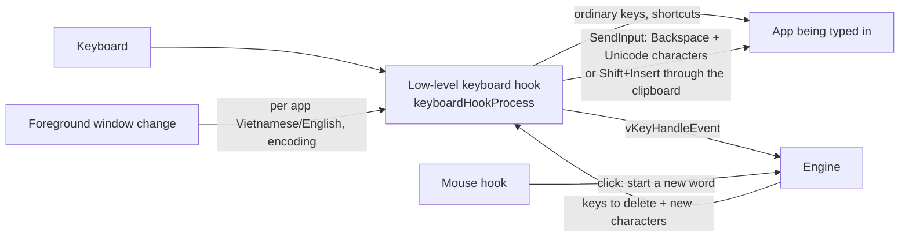

# EasyKey design

[Tiếng Việt](DESIGN.md) · **English**

> Version 1.0.17 · Windows 11 x64 · C++ / Win32, Direct2D, DirectWrite

This document explains how EasyKey works and how its source code is organized. It is for anyone who wants to read, change or contribute to the code. How to use EasyKey is in the [README](../README.en.md), how to build it in [BUILD](BUILD.en.md), contribution rules in [CONTRIBUTING](../CONTRIBUTING.md).

## Contents
1. [Goals](#1-goals)
2. [Overview](#2-overview)
3. [Handling a key](#3-handling-a-key)
4. [Modifier key state](#4-modifier-key-state)
5. [Keeping the hook alive](#5-keeping-the-hook-alive)
6. [Special cases](#6-special-cases)
7. [Engine](#7-engine)
8. [User interface](#8-user-interface)
9. [Settings storage](#9-settings-storage)
10. [Updates](#10-updates)
11. [Build and release](#11-build-and-release)
12. [Source map](#12-source-map)
13. [Known limits](#13-known-limits)

## 1. Goals
| Goal | How |
|---|---|
| One file, nothing to install | One x64 `EasyKey.exe`, statically linked CRT, fonts and icons embedded. No DLLs, no installer. |
| No ENG/VIE indicator on the taskbar | EasyKey registers no keyboard layout or TSF service with Windows. It reads keys with a low-level hook. |
| No administrator rights | Everything lives in `HKCU` and the user's folders. Admin rights are used only when the user turns on "Run as administrator". |
| Windows 11 look | Custom-drawn windows: Mica, light/dark following Windows, accent color, DirectWrite, per-monitor DPI. |
| Safe updates | HTTPS downloads from the release page only, SHA-256 check, always asks the user. |

## 2. Overview
EasyKey is a Win32 app written in C++, in two layers:

- **Engine** (`Sources/EasyKey/engine`): plain C++ with no Windows API calls. It takes one key at a time and returns how many characters to delete and which new characters to send. Inherited from OpenKey, with tests that run on Windows and Linux.
- **Windows app** (`Sources/EasyKey/win32/EasyKey/EasyKey`): reads keys, calls the engine, sends the result to the app being typed in, and handles the interface, settings and updates.



Everything runs on the main thread, which owns the message loop. Windows calls the low-level hooks on this thread for every key, so all work in the hook must be quick (see section 5). Slow work such as downloading an update runs on a separate thread.

## 3. Handling a key
EasyKey doesn't hold keys back to "compose" text like a TSF keyboard does. It lets keys reach the app as usual, and when a mark is needed it deletes the old text and sends the new text. For example, typing `g i u p s` in Telex:

| Key | Engine returns | EasyKey does | Screen |
|---|---|---|---|
| g, i, u, p | Nothing to do | Lets the key through | `giup` |
| s | Delete 2, send `úp` | Blocks `s`, sends 2 Backspaces then `ú`, `p` | `giúp` |

In detail, in `keyboardHookProcess` (`EasyKey.cpp`):

1. Skip keys EasyKey sent itself (marked with `dwExtraInfo = EASYKEY_EXTRA_INFO`).
2. Skip when the app has an IME open (Japanese, Chinese...).
3. Update the modifier state (section 4) and check the shortcuts for switching Vietnamese/English, switching input method and quick convert.
4. Game mode and English mode: let the key through (English mode still expands shortcuts if that is on).
5. Call `vKeyHandleEvent` with the key code and upper/lower case. The result is in `vKeyHookState`: `code` (nothing, process, restore keys, shortcut), `backspaceCount`, `newCharCount`, `charData`.
6. If there is work to do: send the Backspaces, then the new characters with `SendInput` and `KEYEVENTF_UNICODE` (default), or put the text on the clipboard and send Shift+Insert ("Send text through the clipboard" option). The original key is blocked (`return -1`).

Legacy encodings (VNI Windows, Unicode combining) have characters two codes long, so EasyKey records the length of each character it sent (`_syncKey`) to send the right number of Backspaces.

## 4. Modifier key state
The engine needs to know whether a key is upper or lower case, and the hook needs to know whether Ctrl, Alt or Win is held to recognize shortcuts. This state lives in `_flag`.

- When Shift, Ctrl, Alt or Win is pressed or released, `SetModifierMask` / `UnsetModifierMask` update `_flag`. Shortcuts made only of modifiers (for example Ctrl + Shift) rely on these events.
- Before every other key, `syncModifierMask` reads the real state again with `GetAsyncKeyState` (Shift, Ctrl, Alt, Win) and `GetKeyState(VK_CAPITAL) & 1` (Caps Lock). It also runs at start-up and when the hooks are put back.

Why the second step: the hook never sees a key being released while it isn't running, for example when Windows removed it, or an elevated window or the lock screen is in front. Before this fix, a Shift "stuck" that way turned every letter EasyKey sent again into a capital ("giÚP tÔi hOÀN thIỆN"). The hook runs before the current key changes the global state, so for a letter key the state read is exact.

## 5. Keeping the hook alive
Windows silently removes a low-level hook that answers slower than `LowLevelHooksTimeout`. Keys then reach the app untouched and the user sees raw keys ("chaats" instead of "chất"). EasyKey notices and puts the hook back in two ways:

- **Raw input** (`onRawKeyboard`): EasyKey also receives every key from a real keyboard through `RegisterRawInputDevices` with `RIDEV_INPUTSINK`. Windows calls the hooks before it produces raw input, so if raw input counts more key presses than the hook did, the hook is gone.
- **2 second timer** (`checkHooks`): if Windows got new input but neither hook ran for over a second, put them back.

Both skip the check while an elevated window is in front, because the hook not seeing keys is expected then. To keep the hook fast, every call that could wait (such as asking for the IME state) has a short limit (`SendMessageTimeout`, 50 ms).

## 6. Special cases
| Case | Handling | Where |
|---|---|---|
| Autocomplete boxes (browser address bars) | Chrome, Edge, Brave: select the last character with Shift+Left so the Backspace also removes the suggestion. Other apps: send an empty character (U+202F) and delete one more. | `keyboardHookProcess`, `_chromiumBrowser` |
| Elevated apps | Windows doesn't let normal apps send keys to them. EasyKey tells the user once per app. The run-as-administrator option uses Task Scheduler to start with Windows without a UAC prompt. | `onElevatedWindow`, `registerAdminTask` |
| Shortcuts with Alt or Win | The hook eats the letter of the shortcut, so the app thinks Alt/Win was pressed alone and opens its menu or Start. EasyKey sends an extra no-op key 0xE8 to prevent that. | `maskMenuKey` |
| Game mode | For games on the list, keys go straight to the game. Game chat defaults to raw input. Enter opens or closes chat; Esc or mouse click exits chat immediately; commands starting with `/` remain raw until Space or Enter. | `_inGame`, `_gameChat`, `exitGameChat` |
| Password field bypass | When focus enters a recognized password field (Win32, Chrome/Edge/Firefox, Electron), EasyKey switches to absolute raw typing: disables all diacritics, macros, auto-capitalization, and buffer restoration. Uses a 3-tier lock-free async architecture with sticky password; never reads field contents. | `_passwordStateWord`, `updatePasswordFieldState`, `passwordProbeWorkerProc` |
| Per app memory | When the foreground window changes (`EVENT_SYSTEM_FOREGROUND`), load the Vietnamese/English mode and encoding saved for that exe and update the ticks in the tray menu. The exe name is read with `PROCESS_QUERY_LIMITED_INFORMATION`, which also works for apps that refuse memory reads. Store apps hosted in `ApplicationFrameHost.exe` are remembered by the process that owns the `CoreWindow` inside the frame. When the name can't be read, the current choice stays instead of being saved for the previous app. | `winEventProcCallback`, `getFrontMostAppExecuteName`, `SmartSwitchKey.cpp` |
| Mouse click | Start a new word, since the caret may have moved. | `mouseHookProcess` |

## 7. Engine
| File | Contents |
|---|---|
| `Engine.cpp/.h` | Entry point `vKeyHandleEvent`, the buffer of the word being typed, Telex/VNI/Simple Telex rules, spell check, key restore, quick typing. Options are global `v...` variables set by the app. |
| `Vietnamese.cpp/.h` | Vowel and consonant tables, mark positions, character tables per encoding. |
| `Macro.cpp/.h` | Shortcuts: storage, lookup, binary load/save. |
| `SmartSwitchKey.cpp/.h` | Per app memory of Vietnamese/English and encoding. |
| `MixedWords.cpp/.h`, `MixedWordsData.h` | Word list for the mixed English and Vietnamese mode (see below). `MixedWordsData.h` is generated by `tools/make_mixed_words.py`. |
| `ConvertTool.cpp/.h` | Converting text between encodings, changing case, removing marks. |
| `DataType.h` | `vKeyHookState` and shared constants. |

Engine tests are in `Sources/EasyKey/tests/EngineTests.cpp` (Telex, VNI, conversion, mixed mode). When you fix an engine bug, add a test for it.

### English–Vietnamese Mixed Mode

Mixed mode is designed to be safe rather than clever. EasyKey only reverts to raw English keys when there is strong evidence, and it does not correct previously committed words by default.

- Valid Vietnamese words with diacritics are not replaced merely because a rare English token, acronym, or proper noun happens to match the typed keys.
- The mixed-mode dictionary is generated offline from language frequency data and filtered to reduce noise from non-common English tokens.
- Language decisions are made per word at word boundaries and never rewind earlier words.
- A small set of homophone contexts is handled with phrase rules. For example, `bánh tét` and `thịt tét` are treated as Vietnamese, while `test` is preserved in common contexts such as `chạy test`, `unit test`, and `test case`.
- For other Vietnamese contexts where `tét` is desired, users can type `tets` explicitly.

Known limitations:
- Mixed mode is optimized for Unicode.
- URLs, emails, domains, and some technical strings may be processed segment by segment.
- Kebab-case strings such as `read-only` or `end-to-end` are currently handled as separate segments divided by `-`.
- Very long tokens are not guaranteed in every case. Esc can restore the raw keys of the current word.

### Game Mode

Game Mode prioritizes protection of control keys. While playing, keys such as `W`, `A`, `S`, `D`, `Q`, `E`, and `R` must reach the game directly without Vietnamese input interference.

- **Window-Bound Game Mode (Alt+Tab Protection)**: Binds to the game window via `HWND + PID` with a 5-second TTL. When users Alt+Tab out and back, `EVENT_SYSTEM_FOREGROUND` can occasionally be delayed or dropped by DWM/DirectComposition/borderless windowed mode. Fast-path in the low-level hook rebinds game state on the very first keystroke without heavy process queries (`GetWindowThreadProcessId`, `OpenProcess`, `QueryFullProcessImageName`) per key.
- **Game Crash & Taskkill Guard (IsWindow Check)**: Validates window existence (`IsWindow`) on fast-path to immediately clean up binding if the game abruptly terminates or crashes.
- **Complete Isolation from SmartSwitchKey**: Game Mode does not overwrite per-app input method memory. While playing, the previous app's language setting remains untouched, and switching back to apps like Chrome or Word preserves their respective input methods.
- **Raw Input by Default in Game Chat (Model W)**: Prevents butchering fast gaming shorthand such as `afk`, `gg`, `wp`, `how`, `as`, `or`. Users can still explicitly opt in per app if Vietnamese typing is desired.
- **Immediate Chat Controls**: Enter opens/closes chat; Esc closes chat and clears buffer; Left, right, or middle mouse clicks exit chat instantly to return control keys during combat. Mouse movement, wheel scrolling, and side buttons (XBUTTON) do not close chat.
- **Slash Game Commands**: Commands starting with `/` (e.g., `/ff`, `/w`, `/give`, `/tp`) remain strictly raw until Space or Enter.
- **Game Window Picker & Top 3 Suggestions**:
  - Heuristic Candidate Ranking: Automatically ranks top 3 candidate windows based on MRU recent foreground (`+100`), fullscreen/maximized state (`+30`), while filtering out system processes (`explorer.exe`, `dwm.exe`, `taskmgr.exe`, ...) and office apps (`winword.exe`, `excel.exe`, ...). Helps select the active window/process directly, substantially reducing the risk of selecting a launcher.
  - Safe Non-blocking Title Fetching: `EnumWindows` does not query titles for all windows to avoid UI hangs on unresponsive external applications. Titles are safely fetched only for the final top candidates via `SendMessageTimeout` (50 ms timeout with `SMTO_ABORTIFHUNG` and `IsHungAppWindow` check).
  - Clear Privilege Boundaries: Detects elevated/admin processes. If a game runs as Administrator while EasyKey runs standard, the candidate is marked `[Admin required]` and prompts the user that Administrator privileges are needed; EasyKey never attempts silent elevation or background restarts.
  - Browse `.exe` Fallback Flow: Provides a "Browse .exe file…" fallback in Settings and Tray menu. Saves only the executable base name (`exeBaseName`, matched case-insensitively) to survive game updates, with explicit guidance to select the actual match binary rather than the launcher.
- **Privacy Guarantees**: Candidate Finder executes strictly on-demand when opening the Tray menu or Settings (never inside the keyboard hook). Window titles are kept transiently in RAM solely for menu rendering, never logged to disk, never written to the Registry, and never transmitted over the network (Zero Telemetry).

Known limitations:
- Executable Basename Collision: Game Mode identifies targets by executable base name. If different applications share the same exe name (e.g., `game.exe`), the configuration applies to both.
- UWP / Microsoft Store Games: Certain UWP/MSIX titles or apps hosted via specialized shells (such as `ApplicationFrameHost.exe`) may not be suggested accurately. Browse .exe can be used if accessible, though access to `WindowsApps` directories may be restricted by Windows.
- Automated tests verify game-mode state-machine logic. Real-world behavior in individual games is covered by manual testing.
- Some fullscreen exclusive games, kernel-level anti-cheats, or proprietary input paths may behave differently.
- Game Mode does not read game content, inspect process memory, or send data off-device.

### Password Field Bypass (Browser & Win32)

When focus is in a clearly identified password input, EasyKey switches to absolute raw typing.

The goal is to prevent password characters from being converted into Vietnamese marks, expanded by macros, auto-capitalized, or affected by Mixed mode.

- 3-Tier Lock-Free Architecture:
  1. Win32 Fast Path (0 ms): Detected immediately via `ES_PASSWORD` on standard Win32 `Edit` controls.
  2. Async Probe Worker (COM MTA): Asynchronous probe via Windows UI Automation (`UIA_IsPasswordPropertyId`), automatic fallback to MSAA (`STATE_SYSTEM_PROTECTED`). Zero telemetry, zero text reading.
  3. 32-bit Atomic State Machine: `PW_NORMAL`, `PW_PASSWORD`, `PW_PENDING` (60 ms timeout protecting the first keystroke from accents). Monotonic generation barrier prevents stale probe overwrite.
  4. Sticky Password: Keeps bypass active when user clicks Show/Hide Password toggle on the same focus key.
  5. Continuous Typing Protection & Mouse-Up Reprobe: Suppresses probes during continuous typing `< 150 ms` (protects Omnibox / search boxes); reprobes on `WM_LBUTTONUP` in web contexts with 100 ms throttle and 40 ms debounce.
- Keyboard and mouse hooks read a cached state flag with constant cost.
- Inside a password field, EasyKey disables Telex/VNI marking, Mixed mode, macros, Quick Telex, auto-capitalization, and buffer restoration mechanisms.
- Esc and Enter are passed through to the application.
- EasyKey does not read field contents, does not log keystrokes, does not store password-field state per application, and does not send data off-device.
- The feature can be enabled or disabled in Settings › Advanced (`vPasswordFieldBypass` and `vPasswordFieldUIA`) and is enabled by default.

Known limitations:
- Windows logon, UAC secure prompts, and credential screens running on the secure desktop may be outside the supported scope.
- Certain custom controls, deeply nested shadow DOM, or cross-origin iframes that do not expose password semantics to UIA/MSAA may not be detected.
- EasyKey is not a password manager and does not interact with clipboard, autofill, or page content.

### Testing and Fixtures

Engine tests are public to demonstrate typing behavior, not to describe internal development workflows.

- Test data must be synthetic, local, or simulated.
- Engine tests do not access the network, read real registry state, write outside temporary directories, or contain real user data.
- `example.com` may appear only as documentation text. It is not a service and must not be used as a dependency for testing or monitoring.

## 8. User interface
The interface doesn't use classic Win32 dialogs; it is custom drawn to look like Windows 11 with a compact layout (210px minimum height, single-line `V` · `EV` · `E` mode buttons that rebalance to 2 buttons when `vTwoModesOnly` is on, and a flat input method tab bar with a 2px accent underline):

| File | Role |
|---|---|
| `FluentWindow` | Base for windows: Mica, dark/light title bar, per-monitor DPI, buttons, toggles, choice boxes. |
| `FluentText` | Text drawn with DirectWrite (smooth at every scale), measure-to-fit font sizing with floor (`createFluentFontFit`), with the Be Vietnam Pro font embedded in the exe. |
| `FluentUi` | Shared colors, corner radii, sizes. |
| `ThemeHelper` | Reads Windows light/dark mode and accent color, accent presets, contrast checks. |
| `SettingsWindow` | The Settings window: main screen and Advanced (the item list is declared at the top of the file). |
| `FlyoutWindow` | The small popup when switching Vietnamese/English and for notices, drawn with Direct2D (the `EV` badge shrinks to fit via `IDWriteTextLayout::GetMetrics`). |
| `MessageWindow` | Question and notice dialogs in the same style. |
| `SystemTrayHelper`, `TrayGlyph` | The tray icon (a rounded key like the app icon, drawn at the exact pixel size for the DPI for `V`/`EV`/`E`) and the right-click menu. |
| `AboutWindow`, `MacroWindow`, `ConvertToolWindow` | About, Shortcut list, Convert text. |

Interface text comes in two languages, picked with the `TR("Vietnamese", "English")` macro or the `_T()` pairs in the `SettingsWindow` item table.

## 9. Settings storage
- All settings live in `HKCU\Software\EasyKey`. Each option is a `REG_DWORD` value named after its variable (for example `vInputType`, `vCodeTable`, `vSwitchKeyStatus`), read with `APP_GET_DATA` and written with `APP_SET_DATA`.
- Larger data is stored as binary: `macroData` (shortcut list), `smartSwitchKey` (per app memory), `gameApps` (game exe names, one per line).
- On the first start, if `HKCU\Software\TuyenMai\OpenKey` exists, EasyKey copies it.
- Start with Windows: an `EasyKey` value under `HKCU\...\CurrentVersion\Run`, or a Task Scheduler task when run as administrator is on.
- "Remove EasyKey from Windows" deletes `HKCU\Software\EasyKey`, the startup entry and the shortcut.

## 10. Updates
Updates live in `Updater.cpp` and run on a separate thread so the keyboard and mouse never stall:

1. Read `version.json` on the `master` branch (`latestWinVersion.versionName`) and compare it with the running version. Checked at start-up and every 6 hours when automatic checks are on.
2. When the user agrees, download `EasyKey.exe` and `EasyKey.exe.sha256` from `releases/download/<version>/`. Refuse if the SHA-256 doesn't match or the file doesn't start with `MZ`.
3. Write `EasyKey.new.exe`, rename the running file to `EasyKey.old.exe` (Windows allows renaming a running exe but not overwriting it), then rename the new file to `EasyKey.exe`. If any step fails, put things back.
4. Remove the hooks, start the new version with an update argument and quit. The new version waits for the old one to exit and deletes `EasyKey.old.exe`.

## 11. Build and release
- Visual Studio 2022 project (toolset v143); only `Release|x64` is released. Details in [BUILD](BUILD.en.md).
- CI (`.github/workflows/msbuild.yml`): runs the engine tests on Windows and Linux, builds x64, uploads the exe as an artifact and creates a provenance attestation.
- Releasing: raise `versionName` and `versionCode` in `version.json` and add a section to both CHANGELOG files, merge into `master`, then run the MSBuild workflow by hand (Actions › MSBuild › Run workflow). It tags `versionName`, builds, digitally signs the binary using an ECDSA P-256 Authenticode certificate (`tools/signing/sign.ps1`) with RFC 3161 timestamping, pins the thumbprint against `docs/signing/EasyKey-codesign.cer`, generates `signature.json`, computes `EasyKey.exe.sha256` after signing, packages the zip, creates provenance attestations, and publishes the release.
- Running copies read `version.json` on `master` too, so change the version there only when the matching release is about to be published.

## 12. Source map
```
Sources/EasyKey/
├── engine/                 Vietnamese typing engine (plain C++, shared)
├── tests/                  engine tests (CMake)
└── win32/EasyKey/
    ├── EasyKey.sln
    └── EasyKey/
        ├── main.cpp            entry point, restarts as administrator when that is on
        ├── AppDelegate         app lifetime, timers, first start, notices
        ├── EasyKey.cpp         keyboard/mouse hooks, sending keys, hook watchdog
        ├── EasyKeyManager      starts/stops the engine
        ├── EasyKeyHelper       registry, start with Windows, paths, clipboard
        ├── Updater             self update
        ├── *Window, Fluent*    interface (section 8)
        └── fonts/              Be Vietnam Pro (embedded in the exe)
docs/                       documentation and screenshots
tools/                      scripts that make the icons, the font and the mixed mode word list
version.json                latest version, read by running copies to find updates
```

License: the whole project is GPL-3.0. The newly written interface files (`Fluent*`, `FlyoutWindow`, `MessageWindow`, `ThemeHelper`, `TrayGlyph`, `Updater`) are also offered under MIT, as stated in the `SPDX-License-Identifier` line at the top of each file.

## 13. Known limits
- **Hook instead of TSF.** Deleting and resending text can show in apps that track every key themselves (typing tests, some games). In exchange there is no ENG/VIE indicator on the taskbar. TSF is kept for a separate product later.
- **Elevated apps** can be typed in only when EasyKey also runs as administrator.
- **Not code signed yet**, so SmartScreen and antivirus software may warn.
- **Windows x64 only.** No x86, ARM64, macOS or Linux build.
