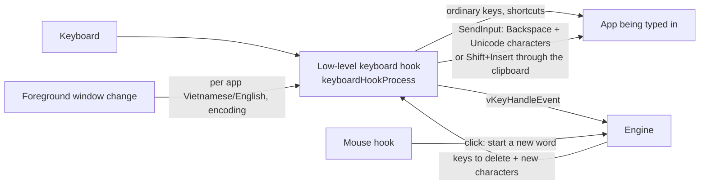

# EasyKey design

[Tiếng Việt](DESIGN.md) · **English**

> Version 1.0.11 · Windows 11 x64 · C++ / Win32, Direct2D, DirectWrite

This document explains how EasyKey works and how its source code is organized. It is for anyone who wants to read, change or contribute to the code. How to use EasyKey is in the [README](../README.en.md), how to build it in [BUILD](BUILD.en.md), contribution rules in [CONTRIBUTING](../CONTRIBUTING.md).

## Contents
1. [Goals](#1-goals)
2. [Overview](#2-overview)
3. [Handling a key](#3-handling-a-key)
4. [Modifier key state](#4-modifier-key-state)
5. [Keeping the hook alive](#5-keeping-the-hook-alive)
6. [Special cases](#6-special-cases)
7. [Engine](#7-engine)
8. [User interface](#8-user-interface)
9. [Settings storage](#9-settings-storage)
10. [Updates](#10-updates)
11. [Build and release](#11-build-and-release)
12. [Source map](#12-source-map)
13. [Known limits](#13-known-limits)

## 1. Goals
| Goal | How |
|---|---|
| One file, nothing to install | One x64 `EasyKey.exe`, statically linked CRT, fonts and icons embedded. No DLLs, no installer. |
| No ENG/VIE indicator on the taskbar | EasyKey registers no keyboard layout or TSF service with Windows. It reads keys with a low-level hook. |
| No administrator rights | Everything lives in `HKCU` and the user's folders. Admin rights are used only when the user turns on "Run as administrator". |
| Windows 11 look | Custom-drawn windows: Mica, light/dark following Windows, accent color, DirectWrite, per-monitor DPI. |
| Safe updates | HTTPS downloads from the release page only, SHA-256 check, always asks the user. |

## 2. Overview
EasyKey is a Win32 app written in C++, in two layers:

- **Engine** (`Sources/EasyKey/engine`): plain C++ with no Windows API calls. It takes one key at a time and returns how many characters to delete and which new characters to send. Inherited from OpenKey, with tests that run on Windows and Linux.
- **Windows app** (`Sources/EasyKey/win32/EasyKey/EasyKey`): reads keys, calls the engine, sends the result to the app being typed in, and handles the interface, settings and updates.



Everything runs on the main thread, which owns the message loop. Windows calls the low-level hooks on this thread for every key, so all work in the hook must be quick (see section 5). Slow work such as downloading an update runs on a separate thread.

## 3. Handling a key
EasyKey doesn't hold keys back to "compose" text like a TSF keyboard does. It lets keys reach the app as usual, and when a mark is needed it deletes the old text and sends the new text. For example, typing `g i u p s` in Telex:

| Key | Engine returns | EasyKey does | Screen |
|---|---|---|---|
| g, i, u, p | Nothing to do | Lets the key through | `giup` |
| s | Delete 2, send `úp` | Blocks `s`, sends 2 Backspaces then `ú`, `p` | `giúp` |

In detail, in `keyboardHookProcess` (`EasyKey.cpp`):

1. Skip keys EasyKey sent itself (marked with `dwExtraInfo = EASYKEY_EXTRA_INFO`).
2. Skip when the app has an IME open (Japanese, Chinese...).
3. Update the modifier state (section 4) and check the shortcuts for switching Vietnamese/English, switching input method and quick convert.
4. Game mode and English mode: let the key through (English mode still expands shortcuts if that is on).
5. Call `vKeyHandleEvent` with the key code and upper/lower case. The result is in `vKeyHookState`: `code` (nothing, process, restore keys, shortcut), `backspaceCount`, `newCharCount`, `charData`.
6. If there is work to do: send the Backspaces, then the new characters with `SendInput` and `KEYEVENTF_UNICODE` (default), or put the text on the clipboard and send Shift+Insert ("Send text through the clipboard" option). The original key is blocked (`return -1`).

Legacy encodings (VNI Windows, Unicode combining) have characters two codes long, so EasyKey records the length of each character it sent (`_syncKey`) to send the right number of Backspaces.

## 4. Modifier key state
The engine needs to know whether a key is upper or lower case, and the hook needs to know whether Ctrl, Alt or Win is held to recognize shortcuts. This state lives in `_flag`.

- When Shift, Ctrl, Alt or Win is pressed or released, `SetModifierMask` / `UnsetModifierMask` update `_flag`. Shortcuts made only of modifiers (for example Ctrl + Shift) rely on these events.
- Before every other key, `syncModifierMask` reads the real state again with `GetAsyncKeyState` (Shift, Ctrl, Alt, Win) and `GetKeyState(VK_CAPITAL) & 1` (Caps Lock). It also runs at start-up and when the hooks are put back.

Why the second step: the hook never sees a key being released while it isn't running, for example when Windows removed it, or an elevated window or the lock screen is in front. Before this fix, a Shift "stuck" that way turned every letter EasyKey sent again into a capital ("giÚP tÔi hOÀN thIỆN"). The hook runs before the current key changes the global state, so for a letter key the state read is exact.

## 5. Keeping the hook alive
Windows silently removes a low-level hook that answers slower than `LowLevelHooksTimeout`. Keys then reach the app untouched and the user sees raw keys ("chaats" instead of "chất"). EasyKey notices and puts the hook back in two ways:

- **Raw input** (`onRawKeyboard`): EasyKey also receives every key from a real keyboard through `RegisterRawInputDevices` with `RIDEV_INPUTSINK`. Windows calls the hooks before it produces raw input, so if raw input counts more key presses than the hook did, the hook is gone.
- **2 second timer** (`checkHooks`): if Windows got new input but neither hook ran for over a second, put them back.

Both skip the check while an elevated window is in front, because the hook not seeing keys is expected then. To keep the hook fast, every call that could wait (such as asking for the IME state) has a short limit (`SendMessageTimeout`, 50 ms).

## 6. Special cases
| Case | Handling | Where |
|---|---|---|
| Autocomplete boxes (browser address bars) | Chrome, Edge, Brave: select the last character with Shift+Left so the Backspace also removes the suggestion. Other apps: send an empty character (U+202F) and delete one more. | `keyboardHookProcess`, `_chromiumBrowser` |
| Elevated apps | Windows doesn't let normal apps send keys to them. EasyKey tells the user once per app. The run-as-administrator option uses Task Scheduler to start with Windows without a UAC prompt. | `onElevatedWindow`, `registerAdminTask` |
| Shortcuts with Alt or Win | The hook eats the letter of the shortcut, so the app thinks Alt/Win was pressed alone and opens its menu or Start. EasyKey sends an extra no-op key 0xE8 to prevent that. | `maskMenuKey` |
| Game mode | For games on the list, keys go straight to the game. Enter opens the chat and marks are added; Enter or Esc ends it. | `_inGame`, `_gameChat` |
| Per app memory | When the foreground window changes (`EVENT_SYSTEM_FOREGROUND`), load the Vietnamese/English mode and encoding saved for that exe and update the ticks in the tray menu. The exe name is read with `PROCESS_QUERY_LIMITED_INFORMATION`, which also works for apps that refuse memory reads. Store apps hosted in `ApplicationFrameHost.exe` are remembered by the process that owns the `CoreWindow` inside the frame. When the name can't be read, the current choice stays instead of being saved for the previous app. | `winEventProcCallback`, `getFrontMostAppExecuteName`, `SmartSwitchKey.cpp` |
| Mouse click | Start a new word, since the caret may have moved. | `mouseHookProcess` |

## 7. Engine
| File | Contents |
|---|---|
| `Engine.cpp/.h` | Entry point `vKeyHandleEvent`, the buffer of the word being typed, Telex/VNI/Simple Telex rules, spell check, key restore, quick typing. Options are global `v...` variables set by the app. |
| `Vietnamese.cpp/.h` | Vowel and consonant tables, mark positions, character tables per encoding. |
| `Macro.cpp/.h` | Shortcuts: storage, lookup, binary load/save. |
| `SmartSwitchKey.cpp/.h` | Per app memory of Vietnamese/English and encoding. |
| `ConvertTool.cpp/.h` | Converting text between encodings, changing case, removing marks. |
| `DataType.h` | `vKeyHookState` and shared constants. |

Engine tests are in `Sources/EasyKey/tests/EngineTests.cpp` (Telex, VNI, conversion). When you fix an engine bug, add a test for it.

## 8. User interface
The interface doesn't use classic Win32 dialogs; it is custom drawn to look like Windows 11:

| File | Role |
|---|---|
| `FluentWindow` | Base for windows: Mica, dark/light title bar, per-monitor DPI, buttons, toggles, choice boxes. |
| `FluentText` | Text drawn with DirectWrite (smooth at every scale), with the Be Vietnam Pro font embedded in the exe. |
| `FluentUi` | Shared colors, corner radii, sizes. |
| `ThemeHelper` | Reads Windows light/dark mode and accent color, accent presets, contrast checks. |
| `SettingsWindow` | The Settings window: main screen and Advanced (the item list is declared at the top of the file). |
| `FlyoutWindow` | The small popup when switching Vietnamese/English and for notices, drawn with Direct2D. |
| `MessageWindow` | Question and notice dialogs in the same style. |
| `SystemTrayHelper`, `TrayGlyph` | The tray icon (a rounded key like the app icon, drawn at the exact pixel size for the DPI) and the right-click menu. |
| `AboutWindow`, `MacroWindow`, `ConvertToolWindow` | About, Shortcut list, Convert text. |

Interface text comes in two languages, picked with the `TR("Vietnamese", "English")` macro or the `_T()` pairs in the `SettingsWindow` item table.

## 9. Settings storage
- All settings live in `HKCU\Software\EasyKey`. Each option is a `REG_DWORD` value named after its variable (for example `vInputType`, `vCodeTable`, `vSwitchKeyStatus`), read with `APP_GET_DATA` and written with `APP_SET_DATA`.
- Larger data is stored as binary: `macroData` (shortcut list), `smartSwitchKey` (per app memory), `gameApps` (game exe names, one per line).
- On the first start, if `HKCU\Software\TuyenMai\OpenKey` exists, EasyKey copies it.
- Start with Windows: an `EasyKey` value under `HKCU\...\CurrentVersion\Run`, or a Task Scheduler task when run as administrator is on.
- "Remove EasyKey from Windows" deletes `HKCU\Software\EasyKey`, the startup entry and the shortcut.

## 10. Updates
Updates live in `Updater.cpp` and run on a separate thread so the keyboard and mouse never stall:

1. Read `version.json` on the `master` branch (`latestWinVersion.versionName`) and compare it with the running version. Checked at start-up and every 6 hours when automatic checks are on.
2. When the user agrees, download `EasyKey.exe` and `EasyKey.exe.sha256` from `releases/download/<version>/`. Refuse if the SHA-256 doesn't match or the file doesn't start with `MZ`.
3. Write `EasyKey.new.exe`, rename the running file to `EasyKey.old.exe` (Windows allows renaming a running exe but not overwriting it), then rename the new file to `EasyKey.exe`. If any step fails, put things back.
4. Remove the hooks, start the new version with an update argument and quit. The new version waits for the old one to exit and deletes `EasyKey.old.exe`.

## 11. Build and release
- Visual Studio 2022 project (toolset v143); only `Release|x64` is released. Details in [BUILD](BUILD.en.md).
- CI (`.github/workflows/msbuild.yml`): runs the engine tests on Windows and Linux, builds x64, uploads the exe as an artifact and creates a provenance attestation.
- Releasing: raise `versionName` and `versionCode` in `version.json` and add a section to both CHANGELOG files, merge into `master`, then run the MSBuild workflow by hand (Actions › MSBuild › Run workflow). It tags `versionName`, builds, produces `EasyKey.exe`, `EasyKey.exe.sha256` and `EasyKey<version>-Windows.zip`, attests them and publishes the release with notes taken from the CHANGELOGs.
- Running copies read `version.json` on `master` too, so change the version there only when the matching release is about to be published.

## 12. Source map
```
Sources/EasyKey/
├── engine/                 Vietnamese typing engine (plain C++, shared)
├── tests/                  engine tests (CMake)
└── win32/EasyKey/
    ├── EasyKey.sln
    └── EasyKey/
        ├── main.cpp            entry point, restarts as administrator when that is on
        ├── AppDelegate         app lifetime, timers, first start, notices
        ├── EasyKey.cpp         keyboard/mouse hooks, sending keys, hook watchdog
        ├── EasyKeyManager      starts/stops the engine
        ├── EasyKeyHelper       registry, start with Windows, paths, clipboard
        ├── Updater             self update
        ├── *Window, Fluent*    interface (section 8)
        └── fonts/              Be Vietnam Pro (embedded in the exe)
docs/                       documentation and screenshots
tools/                      scripts that make the icons and font
version.json                latest version, read by running copies to find updates
```

License: the whole project is GPL-3.0. The newly written interface files (`Fluent*`, `FlyoutWindow`, `MessageWindow`, `ThemeHelper`, `TrayGlyph`, `Updater`) are also offered under MIT, as stated in the `SPDX-License-Identifier` line at the top of each file.

## 13. Known limits
- **Hook instead of TSF.** Deleting and resending text can show in apps that track every key themselves (typing tests, some games). In exchange there is no ENG/VIE indicator on the taskbar. TSF is kept for a separate product later.
- **Elevated apps** can be typed in only when EasyKey also runs as administrator.
- **Not code signed yet**, so SmartScreen and antivirus software may warn.
- **Windows x64 only.** No x86, ARM64, macOS or Linux build.
