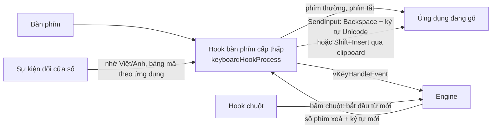

# Tài liệu thiết kế EasyKey

**Tiếng Việt** · [English](DESIGN.en.md)

> Phiên bản 1.0.17 · Windows 11 x64 · C++ / Win32, Direct2D, DirectWrite

Tài liệu này giải thích EasyKey hoạt động thế nào và mã nguồn được tổ chức ra sao. Đối tượng là người muốn đọc, sửa hoặc đóng góp mã. Hướng dẫn dùng nằm ở [README](../README.md), cách build ở [BUILD](BUILD.md), quy tắc đóng góp ở [CONTRIBUTING](../CONTRIBUTING.md).

## Mục lục
1. [Mục tiêu](#1-mục-tiêu)
2. [Tổng quan](#2-tổng-quan)
3. [Xử lý một phím](#3-xử-lý-một-phím)
4. [Trạng thái phím bổ trợ](#4-trạng-thái-phím-bổ-trợ)
5. [Giữ hook luôn hoạt động](#5-giữ-hook-luôn-hoạt-động)
6. [Các trường hợp đặc biệt](#6-các-trường-hợp-đặc-biệt)
7. [Engine](#7-engine)
8. [Giao diện](#8-giao-diện)
9. [Lưu cài đặt](#9-lưu-cài-đặt)
10. [Cập nhật](#10-cập-nhật)
11. [Build và phát hành](#11-build-và-phát-hành)
12. [Bản đồ mã nguồn](#12-bản-đồ-mã-nguồn)
13. [Giới hạn đã biết](#13-giới-hạn-đã-biết)

## 1. Mục tiêu
| Mục tiêu | Cách đạt được |
|---|---|
| Một file, không cài đặt | Một `EasyKey.exe` x64, CRT liên kết tĩnh, font và biểu tượng nhúng trong file. Không DLL, không trình cài đặt. |
| Không hiện ô ENG/VIE trên thanh tác vụ | Không đăng ký bàn phím hay dịch vụ TSF với Windows. EasyKey bắt phím bằng hook cấp thấp. |
| Không cần quyền Admin | Mọi thứ nằm trong `HKCU` và thư mục của người dùng. Quyền Admin chỉ dùng khi người dùng bật "Chạy với quyền Admin". |
| Giao diện Windows 11 | Cửa sổ tự vẽ: Mica, sáng/tối theo Windows, màu nhấn, DirectWrite, DPI theo từng màn hình. |
| An toàn khi cập nhật | Chỉ tải qua HTTPS từ trang phát hành, kiểm tra SHA-256, luôn hỏi người dùng. |

## 2. Tổng quan
EasyKey là một ứng dụng Win32 viết bằng C++, gồm hai lớp:

- **Engine** (`Sources/EasyKey/engine`): thuần C++, không gọi Windows API. Nhận từng phím, trả về số ký tự cần xoá và các ký tự mới. Kế thừa từ OpenKey, có test chạy trên cả Windows và Linux.
- **Ứng dụng Windows** (`Sources/EasyKey/win32/EasyKey/EasyKey`): bắt phím, gọi engine, gửi kết quả vào ứng dụng đang gõ, và lo giao diện, cài đặt, cập nhật.



Mọi việc chạy trên luồng chính, nơi có vòng lặp thông điệp. Hook cấp thấp của Windows gọi vào luồng này cho từng phím, nên mọi xử lý trong hook phải nhanh (xem mục 5). Việc chậm như tải bản cập nhật chạy ở luồng riêng.

## 3. Xử lý một phím
EasyKey không chặn trước để "soạn" chữ như bộ gõ TSF. Nó để phím đi vào ứng dụng như bình thường, và khi cần thêm dấu thì xoá chữ cũ rồi gửi chữ mới. Ví dụ gõ Telex `g i u p s`:

| Phím | Engine trả về | EasyKey làm | Màn hình |
|---|---|---|---|
| g, i, u, p | Không làm gì | Cho phím đi tiếp | `giup` |
| s | Xoá 2, gửi `úp` | Chặn phím `s`, gửi 2 Backspace rồi `ú`, `p` | `giúp` |

Chi tiết trong `keyboardHookProcess` (`EasyKey.cpp`):

1. Bỏ qua phím do chính EasyKey gửi (đánh dấu bằng `dwExtraInfo = EASYKEY_EXTRA_INFO`).
2. Bỏ qua nếu ứng dụng đang bật bộ gõ IME (tiếng Nhật, tiếng Trung...).
3. Cập nhật trạng thái phím bổ trợ (mục 4) và kiểm tra phím tắt chuyển Việt/Anh, đổi kiểu gõ, chuyển mã nhanh.
4. Chế độ game và chế độ tiếng Anh: cho phím đi thẳng (tiếng Anh vẫn xử lý gõ tắt nếu được bật).
5. Gọi `vKeyHandleEvent` với mã phím và trạng thái hoa/thường. Kết quả nằm trong `vKeyHookState`: `code` (không làm gì, xử lý, trả lại phím, gõ tắt), `backspaceCount`, `newCharCount`, `charData`.
6. Nếu cần xử lý: gửi Backspace, rồi gửi ký tự mới bằng `SendInput` với `KEYEVENTF_UNICODE` (mặc định), hoặc đặt chữ vào clipboard rồi gửi Shift+Insert (tuỳ chọn "Gửi chữ qua Clipboard"). Phím gốc bị chặn (`return -1`).

Bảng mã cũ (VNI Windows, Unicode tổ hợp) có ký tự dài hai mã, nên EasyKey ghi lại độ dài từng ký tự đã gửi (`_syncKey`) để xoá đúng số Backspace.

## 4. Trạng thái phím bổ trợ
Engine cần biết phím vừa bấm là chữ hoa hay thường, và hook cần biết Ctrl, Alt, Win có đang giữ không để nhận phím tắt. Trạng thái này nằm trong biến `_flag`.

- Khi bấm hoặc nhả Shift, Ctrl, Alt, Win, `SetModifierMask` / `UnsetModifierMask` cập nhật `_flag`. Phím tắt chỉ gồm phím bổ trợ (ví dụ Ctrl + Shift) dựa vào các sự kiện này.
- Trước mỗi phím thường, `syncModifierMask` đọc lại trạng thái thật bằng `GetAsyncKeyState` (Shift, Ctrl, Alt, Win) và `GetKeyState(VK_CAPITAL) & 1` (Caps Lock). Việc này cũng chạy khi khởi động và khi gắn lại hook.

Lý do của bước thứ hai: hook không thấy sự kiện nhả phím xảy ra lúc nó không chạy, ví dụ khi Windows gỡ hook, khi cửa sổ quyền Admin hay màn hình khoá đang ở trước. Trước bản sửa, Shift bị "kẹt" như vậy làm mọi chữ EasyKey gửi lại thành chữ hoa ("giÚP tÔi hOÀN thIỆN"). Hook chạy trước khi phím hiện tại làm thay đổi trạng thái chung, nên với một phím chữ, trạng thái đọc được là chính xác.

## 5. Giữ hook luôn hoạt động
Windows lặng lẽ gỡ hook cấp thấp nếu nó phản hồi chậm hơn `LowLevelHooksTimeout`. Khi đó phím đi thẳng vào ứng dụng và người dùng thấy phím thô ("chaats" thay vì "chất"). EasyKey phát hiện và gắn lại hook bằng hai cách:

- **Raw input** (`onRawKeyboard`): EasyKey nhận thêm mọi phím từ bàn phím thật qua `RegisterRawInputDevices` với `RIDEV_INPUTSINK`. Windows gọi hook trước khi tạo raw input, nên nếu raw input đếm được nhiều phím hơn hook thì hook đã mất.
- **Hẹn giờ 2 giây** (`checkHooks`): nếu Windows có input mới mà cả hai hook không chạy trong hơn 1 giây, gắn lại.

Cả hai bỏ qua khi cửa sổ đang ở trước chạy quyền Admin, vì lúc đó hook không thấy phím là bình thường. Để hook nhanh, mọi lời gọi có thể chờ (ví dụ hỏi trạng thái IME) đều có thời hạn ngắn (`SendMessageTimeout`, 50 ms).

## 6. Các trường hợp đặc biệt
| Trường hợp | Cách xử lý | Ở đâu |
|---|---|---|
| Ô có gợi ý tự động (thanh địa chỉ trình duyệt) | Chrome, Edge, Brave: chọn ký tự cuối bằng Shift+Left để Backspace xoá luôn phần gợi ý. Ứng dụng khác: gửi một ký tự trống (U+202F) rồi xoá thêm một lần. | `keyboardHookProcess`, `_chromiumBrowser` |
| Ứng dụng quyền Admin | Windows không cho ứng dụng thường gửi phím vào. EasyKey báo một lần cho mỗi ứng dụng. Tuỳ chọn chạy quyền Admin dùng Task Scheduler để khởi động cùng Windows mà không hỏi UAC. | `onElevatedWindow`, `registerAdminTask` |
| Phím tắt có Alt hoặc Win | Hook ăn mất phím chữ của phím tắt, nên ứng dụng tưởng Alt/Win được bấm riêng và mở menu hay Start. EasyKey gửi thêm phím trống 0xE8 để tránh việc này. | `maskMenuKey` |
| Chế độ game | Với game trong danh sách, phím đi thẳng vào game. Khung chat mặc định dùng phím thô. Enter mở/đóng chat; Esc hoặc click chuột thoát chat ngay tức thì; lệnh bắt đầu bằng `/` giữ nguyên dạng phím thô cho tới phím cách hoặc Enter. | `_inGame`, `_gameChat`, `exitGameChat` |
| Bỏ qua ô mật khẩu | Khi con trỏ ở ô mật khẩu (Win32, trình duyệt Chrome/Edge/Firefox, Electron), EasyKey chuyển sang phím thô tuyệt đối: tắt toàn bộ bỏ dấu, gõ tắt, tự động viết hoa và phục hồi đệm. Cơ chế 3 tầng bất đồng bộ không khóa, sticky password, không đọc nội dung ô nhập. | `_passwordStateWord`, `updatePasswordFieldState`, `passwordProbeWorkerProc` |
| Nhớ theo ứng dụng | Khi đổi cửa sổ (`EVENT_SYSTEM_FOREGROUND`), đọc lại Việt/Anh và bảng mã đã lưu cho file exe đó rồi cập nhật dấu chọn ở menu khay. Tên exe đọc bằng `PROCESS_QUERY_LIMITED_INFORMATION` (đủ cho cả ứng dụng không cho quyền đọc bộ nhớ). Ứng dụng Store nằm trong `ApplicationFrameHost.exe` được nhớ theo tiến trình sở hữu cửa sổ `CoreWindow` bên trong khung. Nếu không đọc được tên, giữ nguyên lựa chọn hiện tại thay vì ghi sang ứng dụng trước. | `winEventProcCallback`, `getFrontMostAppExecuteName`, `SmartSwitchKey.cpp` |
| Bấm chuột | Bắt đầu từ mới, vì con trỏ có thể đã sang chỗ khác. | `mouseHookProcess` |

## 7. Engine
| File | Nội dung |
|---|---|
| `Engine.cpp/.h` | Điểm vào `vKeyHandleEvent`, bộ đệm từ đang gõ, quy tắc Telex/VNI/Simple Telex, kiểm tra chính tả, trả lại phím, gõ nhanh. Các tuỳ chọn là biến toàn cục `v...` do ứng dụng đặt. |
| `Vietnamese.cpp/.h` | Bảng nguyên âm, phụ âm, vị trí dấu và bảng ký tự cho từng bảng mã. |
| `Macro.cpp/.h` | Gõ tắt: lưu, tìm, đọc/ghi dạng nhị phân. |
| `SmartSwitchKey.cpp/.h` | Bảng nhớ Việt/Anh và bảng mã theo tên ứng dụng. |
| `MixedWords.cpp/.h`, `MixedWordsData.h` | Danh sách từ cho chế độ Anh–Việt (xem dưới). `MixedWordsData.h` sinh bằng `tools/make_mixed_words.py`. |
| `ConvertTool.cpp/.h` | Chuyển văn bản giữa các bảng mã, đổi hoa/thường, bỏ dấu. |
| `DataType.h` | `vKeyHookState` và các hằng số chung. |

Test engine ở `Sources/EasyKey/tests/EngineTests.cpp` (Telex, VNI, chuyển mã, Anh–Việt). Khi sửa engine, thêm ca test cho lỗi vừa sửa.

### Chế độ Anh–Việt

Chế độ Anh–Việt được thiết kế theo nguyên tắc an toàn hơn thông minh. Bộ gõ chỉ chuyển sang phím tiếng Anh thô khi có bằng chứng đủ mạnh, và mặc định không sửa ngược từ đã gõ trước đó.

- Từ tiếng Việt hợp lệ có dấu không bị thay thế chỉ vì một chuỗi tiếng Anh hiếm, viết tắt hoặc danh từ riêng tình cờ trùng phím gõ.
- Từ điển hỗ trợ chế độ Anh–Việt được sinh ngoại tuyến từ dữ liệu tần suất ngôn ngữ và được lọc để giảm nhiễu từ các token không phải từ tiếng Anh thông dụng.
- Việc đánh giá ngôn ngữ diễn ra theo từng từ, tại ranh giới từ, không can thiệp vào các từ đứng trước.
- Một số cặp đồng âm được xử lý bằng quy tắc cụm từ hạn chế. Ví dụ: `bánh tét` và `thịt tét` được nhận diện là tiếng Việt, trong khi `test` trong các ngữ cảnh phổ biến như `chạy test`, `unit test`, `test case` được giữ nguyên.
- Với các ngữ cảnh tiếng Việt khác của từ `tét`, người dùng có thể gõ `tets` để chủ động nhận về `tét`.

Giới hạn đã biết:
- Chế độ Anh–Việt tối ưu cho bảng mã Unicode.
- URL, email, tên miền và một số chuỗi kỹ thuật có thể được xử lý theo từng phân đoạn.
- Kebab-case như `read-only` hoặc `end-to-end` hiện được xử lý theo từng từ con phân cách bởi dấu `-`.
- Chuỗi rất dài không được bảo đảm tuyệt đối ở mọi trường hợp; phím Esc có thể khôi phục phím thô của từ hiện tại.

### Chế độ Game

Chế độ Game ưu tiên bảo vệ phím điều khiển. Khi đang chơi, các phím như `W`, `A`, `S`, `D`, `Q`, `E`, `R` phải đi thẳng vào game mà không bị bộ gõ tiếng Việt xen vào.

- Khung chat trong game mặc định dùng phím thô để tránh biến các từ chat nhanh như `afk`, `gg`, `wp`, `how`, `as` thành ký tự tiếng Việt sai.
- Người dùng vẫn có thể chủ động chuyển chế độ gõ cho từng ứng dụng nếu muốn gõ tiếng Việt trong chat game.
- Phím Enter được dùng để mở hoặc đóng trạng thái chat trong game, nhưng vẫn truyền tới ứng dụng đích.
- Phím Esc đóng chat và dọn trạng thái bộ gõ.
- Click chuột trái, phải hoặc giữa sẽ thoát trạng thái chat, giúp phím điều khiển trở về game ngay lập tức.
- Di chuột, lăn chuột và các nút chuột phụ không làm thoát chat.
- Các lệnh bắt đầu bằng `/`, ví dụ `/ff`, `/w`, `/give`, `/tp`, được giữ nguyên dạng phím thô cho tới khi gặp phím cách hoặc Enter.

Giới hạn đã biết:
- CI kiểm chứng logic trạng thái bộ gõ trong game. Trải nghiệm thực tế trên từng game cụ thể thuộc phạm vi kiểm thử thủ công.
- Một số game fullscreen exclusive, overlay tùy chỉnh hoặc cơ chế nhập liệu riêng có thể hành xử khác nhau.
- Chế độ Game không đọc nội dung game, không can thiệp vào bộ nhớ tiến trình và không gửi dữ liệu ra ngoài.

### Bỏ qua ô mật khẩu (Browser & Win32)

Khi con trỏ nhập liệu đang ở trong một ô mật khẩu được xác định rõ ràng, EasyKey chuyển sang chế độ phím thô tuyệt đối.

Mục tiêu là tránh việc các ký tự mật khẩu bị biến thành dấu tiếng Việt, gõ tắt, viết hoa tự động hoặc bị xử lý bởi chế độ Anh–Việt.

- Kiến trúc 3 tầng không khóa:
  1. Win32 Fast Path (0 ms): Nhận diện tức thì qua `ES_PASSWORD` trên điều khiển `Edit` chuẩn.
  2. Async Probe Worker (COM MTA): Thăm dò nền qua Windows UI Automation (`UIA_IsPasswordPropertyId`), tự động fallback MSAA (`STATE_SYSTEM_PROTECTED`). Không đọc nội dung, zero-telemetry.
  3. Máy trạng thái nguyên tử 32-bit: `PW_NORMAL`, `PW_PASSWORD`, `PW_PENDING` (thời hạn 60 ms bảo vệ phím bấm đầu tiên khỏi bị dính dấu tiếng Việt). Monotonic generation barrier ngăn chặn stale probe.
  4. Sticky Password: Giữ nguyên bypass khi người dùng bấm chuyển đổi Hiện/Ẩn mật khẩu (Show/Hide Password toggle) trên cùng focus key.
  5. Bảo vệ gõ liên tục & Re-probe chuột: Chặn probe khi đang gõ liên tục `< 150 ms` (bảo vệ Omnibox / search box); tái thăm dò trên `WM_LBUTTONUP` trong vùng web với throttle 100 ms và debounce 40 ms.
- Hook bàn phím và chuột chỉ đọc một cờ trạng thái đã được cache, với chi phí không đổi.
- Trong ô mật khẩu, EasyKey tắt đánh dấu Telex/VNI, chế độ Anh–Việt, gõ tắt, Quick Telex, tự động viết hoa và các cơ chế khôi phục bộ đệm.
- Phím Esc và Enter đi thẳng tới ứng dụng.
- EasyKey không đọc nội dung ô nhập, không ghi nhật ký phím, không lưu trạng thái ô mật khẩu theo ứng dụng và không gửi dữ liệu ra ngoài.
- Tính năng có thể bật/tắt trong Cài đặt › Nâng cao (`vPasswordFieldBypass` và `vPasswordFieldUIA`), mặc định được bật.

Giới hạn đã biết:
- Windows logon, UAC secure prompt và các màn hình credential chạy trên secure desktop có thể nằm ngoài phạm vi hỗ trợ.
- Một số điều khiển tùy chỉnh đặc thù, shadow DOM phức tạp hoặc iframe khác nguồn (cross-origin) không được trình duyệt phơi bày thuộc tính mật khẩu qua UIA/MSAA có thể không được nhận diện.
- EasyKey không phải trình quản lý mật khẩu và không can thiệp vào clipboard, autofill hay nội dung trang web.

### Kiểm thử và dữ liệu mẫu

Các kiểm thử engine được công khai để chứng minh hành vi bộ gõ, không phải để mô tả quy trình phát triển nội bộ.

- Dữ liệu kiểm thử phải là chuỗi tổng hợp, cục bộ hoặc giả lập.
- Kiểm thử engine không gọi mạng, không đọc registry thật, không ghi file ngoài thư mục tạm và không chứa dữ liệu người dùng thật.
- `example.com` chỉ có thể xuất hiện như chuỗi minh họa trong tài liệu. Đây không phải một dịch vụ và không được dùng làm dependency cho kiểm thử hoặc giám sát.

## 8. Giao diện
Giao diện không dùng hộp thoại Win32 cổ điển mà tự vẽ để giống Windows 11, mật độ hiển thị gọn (chiều cao tối thiểu 210px, các nút chế độ `V` · `EV` · `E` 1 dòng tự cân lại 2 nút khi bật `vTwoModesOnly`, thanh kiểu gõ dạng tab gạch chân 2px):

| File | Vai trò |
|---|---|
| `FluentWindow` | Lớp nền cho cửa sổ: Mica, thanh tiêu đề tối/sáng, DPI theo màn hình, vẽ nút, công tắc, ô chọn. |
| `FluentText` | Vẽ chữ bằng DirectWrite (nét mịn ở mọi mức phóng to), tự co cỡ chữ vừa khung có ngưỡng sàn (`createFluentFontFit`), font Be Vietnam Pro nhúng trong exe. |
| `FluentUi` | Màu, bo góc, kích thước dùng chung. |
| `ThemeHelper` | Đọc chế độ sáng/tối và màu nhấn của Windows, bảng màu nhấn có sẵn, tính tương phản. |
| `SettingsWindow` | Cửa sổ Cài đặt: màn hình chính và phần Nâng cao (danh sách mục khai báo ở đầu file). |
| `FlyoutWindow` | Popup nhỏ khi chuyển Việt/Anh và các thông báo, vẽ bằng Direct2D (ô hiệu `EV` tự co vừa theo `IDWriteTextLayout::GetMetrics`). |
| `MessageWindow` | Hộp thoại hỏi/thông báo cùng phong cách. |
| `SystemTrayHelper`, `TrayGlyph` | Biểu tượng khay (phím bo góc như biểu tượng ứng dụng, vẽ đúng cỡ pixel theo DPI cho `V`/`EV`/`E`) và menu chuột phải. |
| `AboutWindow`, `MacroWindow`, `ConvertToolWindow` | Giới thiệu, Bảng gõ tắt, Công cụ chuyển mã. |

Chữ trên giao diện có hai ngôn ngữ, chọn bằng macro `TR("tiếng Việt", "English")` hoặc cặp `_T()` trong bảng mục của `SettingsWindow`.

## 9. Lưu cài đặt
- Mọi cài đặt nằm trong `HKCU\Software\EasyKey`. Mỗi tuỳ chọn là một giá trị `REG_DWORD` cùng tên biến (ví dụ `vInputType`, `vCodeTable`, `vSwitchKeyStatus`), đọc bằng `APP_GET_DATA` và ghi bằng `APP_SET_DATA`.
- Dữ liệu lớn lưu dạng nhị phân: `macroData` (bảng gõ tắt), `smartSwitchKey` (nhớ theo ứng dụng), `gameApps` (tên exe các game, mỗi dòng một tên).
- Lần đầu chạy, nếu có `HKCU\Software\TuyenMai\OpenKey`, EasyKey chép sang.
- Chạy cùng Windows: giá trị `EasyKey` trong `HKCU\...\CurrentVersion\Run`, hoặc một tác vụ Task Scheduler khi bật chạy quyền Admin.
- "Gỡ EasyKey khỏi Windows" xoá khoá `HKCU\Software\EasyKey`, mục chạy cùng Windows và lối tắt.

## 10. Cập nhật
Cập nhật nằm trong `Updater.cpp`, chạy ở luồng riêng để không làm khựng bàn phím và chuột:

1. Đọc `version.json` trên nhánh `master` (`latestWinVersion.versionName`) và so với phiên bản đang chạy. Kiểm tra lúc khởi động và 6 giờ một lần nếu bật tự kiểm tra.
2. Khi người dùng đồng ý, tải `EasyKey.exe` và `EasyKey.exe.sha256` từ `releases/download/<phiên bản>/`. Từ chối nếu mã SHA-256 không khớp hoặc file không bắt đầu bằng `MZ`.
3. Ghi `EasyKey.new.exe`, đổi tên file đang chạy thành `EasyKey.old.exe` (Windows cho đổi tên nhưng không cho ghi đè exe đang chạy), rồi đổi tên file mới thành `EasyKey.exe`. Lỗi ở bước nào thì trả lại như cũ.
4. Gỡ hook, chạy bản mới với tham số cập nhật rồi thoát. Bản mới chờ bản cũ thoát hẳn và xoá `EasyKey.old.exe`.

## 11. Build và phát hành
- Dự án Visual Studio 2022 (toolset v143), chỉ cấu hình `Release|x64` được phát hành. Chi tiết ở [BUILD](BUILD.md).
- CI (`.github/workflows/msbuild.yml`): chạy test engine trên Windows và Linux, build x64, tải exe lên mục Artifacts và tạo chứng thực nguồn gốc.
- Phát hành: cập nhật `versionName` và `versionCode` trong `version.json` và thêm mục vào hai file CHANGELOG, merge vào `master`, rồi chạy tay workflow MSBuild (Actions › MSBuild › Run workflow). Workflow tạo tag trùng `versionName`, build, ký số Authenticode bằng ECDSA P-256 (`tools/signing/sign.ps1`) với timestamp RFC 3161, ghim thumbprint đối chiếu với `docs/signing/EasyKey-codesign.cer`, sinh `signature.json`, tính `EasyKey.exe.sha256` sau khi ký, đóng gói zip, chứng thực nguồn gốc và tạo trang phát hành.
- Bản đang chạy cũng đọc `version.json` trên `master`, nên chỉ đổi phiên bản trong file này khi bản phát hành tương ứng sắp có.

## 12. Bản đồ mã nguồn
```
Sources/EasyKey/
├── engine/                 engine gõ tiếng Việt (C++ thuần, dùng chung)
├── tests/                  test engine (CMake)
└── win32/EasyKey/
    ├── EasyKey.sln
    └── EasyKey/
        ├── main.cpp            điểm vào, tự chạy lại với quyền Admin nếu được bật
        ├── AppDelegate         vòng đời ứng dụng, hẹn giờ, lần chạy đầu, thông báo
        ├── EasyKey.cpp         hook bàn phím/chuột, gửi phím, theo dõi hook
        ├── EasyKeyManager      bật/tắt engine
        ├── EasyKeyHelper       registry, chạy cùng Windows, đường dẫn, clipboard
        ├── Updater             tự cập nhật
        ├── *Window, Fluent*    giao diện (mục 8)
        └── fonts/              Be Vietnam Pro (nhúng vào exe)
docs/                       tài liệu và ảnh chụp
tools/                      script tạo biểu tượng, font và danh sách từ Anh–Việt
version.json                phiên bản mới nhất, bản đang chạy đọc để biết có cập nhật
```

Giấy phép: toàn bộ dự án là GPL-3.0. Các file giao diện viết mới (`Fluent*`, `FlyoutWindow`, `MessageWindow`, `ThemeHelper`, `TrayGlyph`, `Updater`) được cấp thêm MIT, ghi ở dòng `SPDX-License-Identifier` đầu mỗi file.

## 13. Giới hạn đã biết
- **Hook thay vì TSF.** Cách xoá rồi gửi lại có thể lộ ra với ứng dụng tự theo dõi từng phím (trang luyện gõ, một số game). Bù lại không có ô ENG/VIE trên thanh tác vụ. TSF được để dành cho một sản phẩm riêng sau này.
- **Ứng dụng quyền Admin** chỉ gõ được khi EasyKey cũng chạy quyền Admin.
- **Chứng chỉ ký số tự ký (self-signed).** Bản phát hành được ký Authenticode ECDSA nội bộ và ghim thumbprint để người dùng tự xác thực tính toàn vẹn. Vì chưa qua CA thương mại trong Microsoft Trusted Root Program, Windows SmartScreen vẫn có thể hiển thị cảnh báo 'Unknown publisher' cho đến khi chuyển đổi sang chứng chỉ thương mại/Azure Trusted Signing trong tương lai.
- **Chỉ Windows x64.** Không có bản x86, ARM64, macOS hay Linux.
