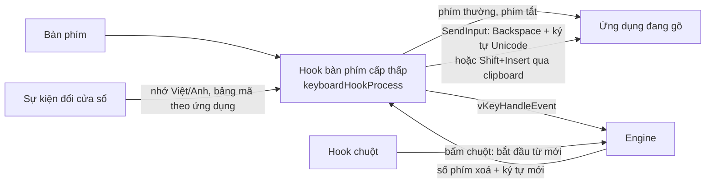

# Tài liệu thiết kế EasyKey

**Tiếng Việt** · [English](DESIGN.en.md)

> Phiên bản 1.0.23 · Windows 11 x64 · C++ / Win32, Direct2D, DirectWrite

Tài liệu này giải thích EasyKey hoạt động thế nào và mã nguồn được tổ chức ra sao. Đối tượng là người muốn đọc, sửa hoặc đóng góp mã. Hướng dẫn dùng nằm ở [README](../README.md), cách build ở [BUILD](BUILD.md), quy tắc đóng góp ở [CONTRIBUTING](../CONTRIBUTING.md).

## Mục lục
1. [Mục tiêu](#1-mục-tiêu)
2. [Tổng quan](#2-tổng-quan)
3. [Xử lý một phím](#3-xử-lý-một-phím)
4. [Trạng thái phím bổ trợ](#4-trạng-thái-phím-bổ-trợ)
5. [Giữ hook luôn hoạt động](#5-giữ-hook-luôn-hoạt-động)
6. [Các trường hợp đặc biệt](#6-các-trường-hợp-đặc-biệt)
7. [Engine](#7-engine)
8. [Giao diện](#8-giao-diện)
9. [Lưu cài đặt](#9-lưu-cài-đặt)
10. [Cập nhật](#10-cập-nhật)
11. [Build và phát hành](#11-build-và-phát-hành)
12. [Bản đồ mã nguồn](#12-bản-đồ-mã-nguồn)
13. [Giới hạn đã biết](#13-giới-hạn-đã-biết)

## 1. Mục tiêu
| Mục tiêu | Cách đạt được |
|---|---|
| Một file, không cài đặt | Một `EasyKey.exe` x64, CRT liên kết tĩnh, font và biểu tượng nhúng trong file. Không DLL, không trình cài đặt. |
| Không hiện ô ENG/VIE trên thanh tác vụ | Không đăng ký bàn phím hay dịch vụ TSF với Windows. EasyKey bắt phím bằng hook cấp thấp. |
| Không cần quyền Admin | Mọi thứ nằm trong `HKCU` và thư mục của người dùng. Quyền Admin chỉ dùng khi người dùng bật "Chạy với quyền Admin". |
| Giao diện Windows 11 | Cửa sổ tự vẽ: Mica, sáng/tối theo Windows, màu nhấn, DirectWrite, DPI theo từng màn hình. |
| An toàn khi cập nhật | Chỉ tải qua HTTPS từ trang phát hành, kiểm tra SHA-256, luôn hỏi người dùng. |

## 2. Tổng quan
EasyKey là một ứng dụng Win32 viết bằng C++, gồm hai lớp:

- **Engine** (`Sources/EasyKey/engine`): thuần C++, không gọi Windows API. Nhận từng phím, trả về số ký tự cần xoá và các ký tự mới. Kế thừa từ OpenKey, có test chạy trên cả Windows và Linux.
- **Ứng dụng Windows** (`Sources/EasyKey/win32/EasyKey/EasyKey`): bắt phím, gọi engine, gửi kết quả vào ứng dụng đang gõ, và lo giao diện, cài đặt, cập nhật.



Mọi việc chạy trên luồng chính, nơi có vòng lặp thông điệp. Hook cấp thấp của Windows gọi vào luồng này cho từng phím, nên mọi xử lý trong hook phải nhanh (xem mục 5). Việc chậm như tải bản cập nhật chạy ở luồng riêng.

## 3. Xử lý một phím
EasyKey không chặn trước để "soạn" chữ như bộ gõ TSF. Nó để phím đi vào ứng dụng như bình thường, và khi cần thêm dấu thì xoá chữ cũ rồi gửi chữ mới. Ví dụ gõ Telex `g i u p s`:

| Phím | Engine trả về | EasyKey làm | Màn hình |
|---|---|---|---|
| g, i, u, p | Không làm gì | Cho phím đi tiếp | `giup` |
| s | Xoá 2, gửi `úp` | Chặn phím `s`, gửi 2 Backspace rồi `ú`, `p` | `giúp` |

Chi tiết trong `keyboardHookProcess` (`EasyKey.cpp`):

1. Bỏ qua phím do chính EasyKey gửi (đánh dấu bằng `dwExtraInfo = EASYKEY_EXTRA_INFO`).
2. Bỏ qua nếu ứng dụng đang bật bộ gõ IME (tiếng Nhật, tiếng Trung...).
3. Cập nhật trạng thái phím bổ trợ (mục 4) và kiểm tra phím tắt chuyển Việt/Anh, đổi kiểu gõ, chuyển mã nhanh.
4. Chế độ game và chế độ tiếng Anh: cho phím đi thẳng (tiếng Anh vẫn xử lý gõ tắt nếu được bật).
5. Gọi `vKeyHandleEvent` với mã phím và trạng thái hoa/thường. Kết quả nằm trong `vKeyHookState`: `code` (không làm gì, xử lý, trả lại phím, gõ tắt), `backspaceCount`, `newCharCount`, `charData`.
6. Nếu cần xử lý: gửi Backspace, rồi gửi ký tự mới bằng `SendInput` với `KEYEVENTF_UNICODE` (mặc định), hoặc đặt chữ vào clipboard rồi gửi Shift+Insert (tuỳ chọn "Gửi chữ qua Clipboard"). Phím gốc bị chặn (`return -1`).

Bảng mã cũ (VNI Windows, Unicode tổ hợp) có ký tự dài hai mã, nên EasyKey ghi lại độ dài từng ký tự đã gửi (`_syncKey`) để xoá đúng số Backspace.

## 4. Trạng thái phím bổ trợ
Engine cần biết phím vừa bấm là chữ hoa hay thường, và hook cần biết Ctrl, Alt, Win có đang giữ không để nhận phím tắt. Trạng thái này nằm trong biến `_flag`.

- Khi bấm hoặc nhả Shift, Ctrl, Alt, Win, `SetModifierMask` / `UnsetModifierMask` cập nhật `_flag`. Phím tắt chỉ gồm phím bổ trợ (ví dụ Ctrl + Shift) dựa vào các sự kiện này.
- Trước mỗi phím thường, `syncModifierMask` đọc lại trạng thái thật bằng `GetAsyncKeyState` (Shift, Ctrl, Alt, Win) và `GetKeyState(VK_CAPITAL) & 1` (Caps Lock). Việc này cũng chạy khi khởi động và khi gắn lại hook.

Lý do của bước thứ hai: hook không thấy sự kiện nhả phím xảy ra lúc nó không chạy, ví dụ khi Windows gỡ hook, khi cửa sổ quyền Admin hay màn hình khoá đang ở trước. Trước bản sửa, Shift bị "kẹt" như vậy làm mọi chữ EasyKey gửi lại thành chữ hoa ("giÚP tÔi hOÀN thIỆN"). Hook chạy trước khi phím hiện tại làm thay đổi trạng thái chung, nên với một phím chữ, trạng thái đọc được là chính xác.

## 5. Giữ hook luôn hoạt động
Windows lặng lẽ gỡ hook cấp thấp nếu nó phản hồi chậm hơn `LowLevelHooksTimeout`. Khi đó phím đi thẳng vào ứng dụng và người dùng thấy phím thô ("chaats" thay vì "chất"). EasyKey phát hiện và gắn lại hook bằng hai cách:

- **Raw input** (`onRawKeyboard`): EasyKey nhận thêm mọi phím từ bàn phím thật qua `RegisterRawInputDevices` với `RIDEV_INPUTSINK`. Windows gọi hook trước khi tạo raw input, nên nếu raw input đếm được nhiều phím hơn hook thì hook đã mất.
- **Hẹn giờ 2 giây** (`checkHooks`): nếu Windows có input mới mà cả hai hook không chạy trong hơn 1 giây, gắn lại.

Cả hai bỏ qua khi cửa sổ đang ở trước chạy quyền Admin, vì lúc đó hook không thấy phím là bình thường. Để hook nhanh, mọi lời gọi có thể chờ (ví dụ hỏi trạng thái IME) đều có thời hạn ngắn (`SendMessageTimeout`, 50 ms).

## 6. Các trường hợp đặc biệt
| Trường hợp | Cách xử lý | Ở đâu |
|---|---|---|
| Ô có gợi ý tự động (thanh địa chỉ trình duyệt) | Chrome, Edge, Brave: chọn ký tự cuối bằng Shift+Left để Backspace xoá luôn phần gợi ý. Ứng dụng khác: gửi một ký tự trống (U+202F) rồi xoá thêm một lần. | `keyboardHookProcess`, `_chromiumBrowser` |
| Ứng dụng quyền Admin | Windows không cho ứng dụng thường gửi phím vào. EasyKey báo một lần cho mỗi ứng dụng. Tuỳ chọn chạy quyền Admin dùng Task Scheduler để khởi động cùng Windows mà không hỏi UAC. | `onElevatedWindow`, `registerAdminTask` |
| Phím tắt có Alt hoặc Win | Hook ăn mất phím chữ của phím tắt, nên ứng dụng tưởng Alt/Win được bấm riêng và mở menu hay Start. EasyKey gửi thêm phím trống 0xE8 để tránh việc này. | `maskMenuKey` |
| Chế độ game | Với game trong danh sách, phím đi thẳng vào game. Enter mở chat để gõ theo chế độ đang bật; Esc hoặc click chuột về trận; lệnh `/` giữ phím thô. Xem [Chế độ game](#chế-độ-game). | `_game.inGame`, `_game.chatOpen`, `exitGameChat` |
| Ô mật khẩu | Gõ phím thô trong ô mật khẩu (Win32, Chrome/Edge/Firefox, Electron), nhận ra ở luồng nền, không đọc nội dung ô. Xem [Ô mật khẩu](#ô-mật-khẩu). | `_passwordStateWord`, `updatePasswordFieldState`, `passwordProbeWorkerProc` |
| Nhớ theo ứng dụng | Khi đổi cửa sổ (`EVENT_SYSTEM_FOREGROUND`), đọc lại chế độ gõ (Việt, Anh–Việt, Anh) và bảng mã đã lưu cho file exe đó rồi cập nhật dấu chọn ở menu khay. Tên exe đọc bằng `PROCESS_QUERY_LIMITED_INFORMATION` (đủ cho cả ứng dụng không cho quyền đọc bộ nhớ). Ứng dụng Store nằm trong `ApplicationFrameHost.exe` được nhớ theo tiến trình sở hữu cửa sổ `CoreWindow` bên trong khung. Nếu không đọc được tên, giữ nguyên lựa chọn hiện tại thay vì ghi sang ứng dụng trước. | `winEventProcCallback`, `getFrontMostAppExecuteName`, `SmartSwitchKey.cpp` |
| Bấm chuột | Bắt đầu từ mới, vì con trỏ có thể đã sang chỗ khác. | `mouseHookProcess` |

## 7. Engine
| File | Nội dung |
|---|---|
| `Engine.cpp/.h` | Điểm vào `vKeyHandleEvent`, bộ đệm từ đang gõ, quy tắc Telex/VNI/Simple Telex, kiểm tra chính tả, trả lại phím, gõ nhanh. Các tuỳ chọn là biến toàn cục `v...` do ứng dụng đặt. |
| `Vietnamese.cpp/.h` | Bảng nguyên âm, phụ âm, vị trí dấu và bảng ký tự cho từng bảng mã. |
| `Macro.cpp/.h` | Gõ tắt: lưu, tìm, đọc/ghi dạng nhị phân. |
| `SmartSwitchKey.cpp/.h` | Bảng nhớ chế độ gõ và bảng mã theo tên ứng dụng. |
| `MixedWords.cpp/.h`, `MixedWordsData.h` | Danh sách từ cho chế độ Anh–Việt (xem dưới). `MixedWordsData.h` sinh bằng `tools/make_mixed_words.py`. |
| `ConvertTool.cpp/.h` | Chuyển văn bản giữa các bảng mã, đổi hoa/thường, bỏ dấu. |
| `DataType.h` | `vKeyHookState` và các hằng số chung. |

Test engine ở `Sources/EasyKey/tests/EngineTests.cpp` (Telex, VNI, chuyển mã, Anh–Việt). Khi sửa engine, thêm ca test cho lỗi vừa sửa.

### Chế độ Anh–Việt

Nguyên tắc: **an toàn hơn thông minh**. EasyKey chỉ trả lại phím tiếng Anh khi có
bằng chứng đủ mạnh, và quyết định theo từng từ ở ranh giới từ, không sửa lại từ
đã gõ trước đó (`mixedFixLast` tắt mặc định).

Một từ vừa gõ xong được xét lần lượt qua các bước sau, bước nào kết luận được
thì dừng:

1. **Chuỗi dạng mã nguồn**: `snake_case`, `camelCase`, chữ lẫn số, email. Giữ phím gốc.
2. **Từ viết tắt viết hoa** (`US`, `AI`, `UK`, `IF`, `OR`…) và danh sách từ công nghệ chọn lọc (`qwen`, `claude`, `commit`…). Giữ phím gốc.
3. **Quy tắc cụm hai từ**: `xe bus`, `mập ú`, `một tô`, `bánh tét`, `thịt tét` là tiếng Việt; `with us`, `me too`, `chạy test`, `unit test` là tiếng Anh.
4. **Bảo vệ từ Việt ngắn hay khẩu ngữ**: ở ngữ cảnh trung tính, `bus` → `bú`, `us` → `ú`, `too` → `tô`.
5. **Điểm tần suất** của từ trong mỗi thứ tiếng, có tính từ đứng trước.
6. Không đủ bằng chứng thì **giữ tiếng Việt**.

Danh sách từ (`MixedWordsData.h`) sinh ngoại tuyến từ dữ liệu wordfreq bằng
`tools/make_mixed_words.py`, đã lọc bớt token không phải từ tiếng Anh thông dụng.
Muốn "tét" ở ngữ cảnh khác thì gõ `tets`.

Giới hạn đã biết:
- Tối ưu cho bảng mã Unicode.
- URL, tên miền và kebab-case (`read-only`, `end-to-end`) được xét theo từng đoạn.
- Chuỗi rất dài không bảo đảm đúng mọi trường hợp; Esc trả lại phím gốc của từ hiện tại.

### Chế độ game

Mục tiêu: trong game, phím điều khiển (`W`, `A`, `S`, `D`, `Q`, `E`, `R`…) phải
đi thẳng vào game, còn khung chat vẫn gõ được tiếng Việt.

**Nhận ra game.** Danh sách game lưu theo tên file exe (`gameApps`, không phân
biệt hoa thường). Khi cửa sổ của game lên trước, EasyKey gắn trạng thái game
vào đúng cửa sổ đó (cặp `HWND + PID`). Liên kết được giữ suốt đời cửa sổ và chỉ
bị gỡ khi cửa sổ đóng (`IsWindow`), PID đổi, game bị xoá khỏi danh sách hoặc
EasyKey gắn sang cửa sổ game khác. Alt+Tab quay lại thì hook gắn lại ngay ở phím
đầu tiên mà không gọi API nặng; game tạo lại cửa sổ cũng được gắn lại. Cửa sổ
launcher hay sảnh chờ có ô nhập liệu thật (Edit, ComboBox, nhân Chrome) không bị
coi là game và gõ như ứng dụng thường.

**Trong trận.** Phím đi thẳng, phím tắt của EasyKey bị bỏ qua. Trạng thái phím
bổ trợ vẫn được theo dõi và được làm sạch khi vào hoặc rời game, nên Alt+Enter
hay Ctrl+Enter không mở nhầm chat.

**Khung chat.** Enter mở chat; từ đó phím đi qua engine theo chế độ đang bật
(Việt, Anh–Việt hoặc Anh). Enter cũng được đưa qua engine trước khi đóng chat để
từ cuối được bỏ dấu đủ. Esc đóng chat và xoá bộ đệm; click chuột trái, phải hoặc
giữa đưa phím về trận ngay (di chuột, lăn chuột, nút chuột phụ thì không). Lệnh
bắt đầu bằng `/` giữ phím thô tới dấu cách hoặc Enter. Game bỏ qua phím giả lập
(`SendInput`) thì người dùng chuyển sang Anh để chat.

**Tách khỏi bộ nhớ theo ứng dụng.** Chế độ game không ghi gì vào `smartSwitchKey`:
đổi chế độ trong chat không ghi đè lựa chọn đã nhớ của ứng dụng khác, và Alt+Tab
ra Chrome hay Word vẫn đúng chế độ đã nhớ.

**Gợi ý game** (`GameCandidateFinder.cpp`). Chỉ chạy khi người dùng mở menu khay
hoặc Cài đặt, không bao giờ trong hook. Xếp hạng 3 cửa sổ: lên trước gần đây
(+100), toàn màn hình (+30), loại tiến trình hệ thống và ứng dụng văn phòng. Chỉ
lấy tiêu đề cho các ứng viên cuối, bằng `SendMessageTimeout` 50 ms với
`SMTO_ABORTIFHUNG`, nên ứng dụng bị treo không làm treo menu. Tiêu đề chỉ nằm
trong bộ nhớ, không ghi ra đĩa. Game chạy quyền Admin được đánh dấu `[Quyền Admin]`
và EasyKey nhắc người dùng; EasyKey không tự nâng quyền. "Duyệt file .exe…" là
đường dự phòng, kèm nhắc chọn file của trận chứ không phải launcher.

Giới hạn đã biết:
- Các game trùng tên file exe dùng chung một cài đặt.
- Một số game Microsoft Store (chạy qua `ApplicationFrameHost.exe`) có thể không được gợi ý; thư mục `WindowsApps` có thể không cho duyệt.
- Game có anti-cheat mức kernel, fullscreen exclusive hay cách nhận phím riêng có thể hành xử khác nhau. Test tự động chỉ kiểm logic trạng thái, còn từng game phải thử bằng tay.

### Ô mật khẩu

Khi con trỏ ở ô mật khẩu, EasyKey gõ phím thô: tắt bỏ dấu, Anh–Việt, gõ tắt, gõ
nhanh, tự viết hoa và khôi phục bộ đệm. Esc và Enter đi thẳng tới ứng dụng.

Cách nhận ra ô mật khẩu, không có bước nào chặn hook:

1. **Win32**: ô `Edit` có `ES_PASSWORD` được nhận ra ngay.
2. **Trình duyệt, Electron**: một luồng nền (COM MTA) hỏi UI Automation (`UIA_IsPasswordPropertyId`), không được thì hỏi MSAA (`STATE_SYSTEM_PROTECTED`).
3. **Trạng thái nguyên tử** `_passwordStateWord`: `PW_NORMAL`, `PW_PASSWORD` hoặc `PW_PENDING`. Trong 60 ms chờ kết quả, phím đầu tiên được giữ thô. Bộ đếm thế hệ bỏ qua kết quả cũ khi focus đã đổi.
4. **Giữ nguyên khi bấm Hiện/Ẩn mật khẩu** trên cùng một ô.
5. **Không hỏi khi đang gõ dồn** (< 150 ms giữa hai phím, để ô tìm kiếm không bị chậm); hỏi lại khi nhả chuột trong vùng web (giới hạn 100 ms, chờ 40 ms).

Hook bàn phím và chuột chỉ đọc cờ đã có sẵn. EasyKey không đọc nội dung ô,
không ghi phím, không lưu trạng thái theo ứng dụng. Tắt được trong Cài đặt ›
Nâng cao › Gõ (`vPasswordFieldBypass`); riêng phần trình duyệt tắt bằng registry
`vPasswordFieldUIA = 0`.

Giới hạn đã biết: màn hình đăng nhập Windows, hộp UAC và secure desktop nằm
ngoài tầm; ô tự vẽ, shadow DOM phức tạp hay iframe khác nguồn không báo thuộc
tính mật khẩu thì không nhận ra được.

### Test

- Test engine (`Sources/EasyKey/tests`) chỉ dùng dữ liệu tự tạo, không gọi mạng, không đọc registry thật và không ghi file ngoài thư mục tạm.
- Khi sửa lỗi engine, thêm một ca test cho đúng lỗi đó.

## 8. Giao diện
Giao diện không dùng hộp thoại Win32 cổ điển mà tự vẽ để giống Windows 11, mật độ hiển thị gọn (chiều cao tối thiểu 210px, các nút chế độ `V` · `EV` · `E` 1 dòng tự cân lại 2 nút khi bật `vTwoModesOnly`, thanh kiểu gõ dạng tab gạch chân 2px):

| File | Vai trò |
|---|---|
| `FluentWindow` | Lớp nền cho cửa sổ: Mica, thanh tiêu đề tối/sáng, DPI theo màn hình, vẽ nút, công tắc, ô chọn. |
| `FluentText` | Vẽ chữ bằng DirectWrite (nét mịn ở mọi mức phóng to), tự co cỡ chữ vừa khung có ngưỡng sàn (`createFluentFontFit`), font Be Vietnam Pro nhúng trong exe. |
| `FluentUi` | Màu, bo góc, kích thước dùng chung. |
| `ThemeHelper` | Đọc chế độ sáng/tối và màu nhấn của Windows, bảng màu nhấn có sẵn, tính tương phản. |
| `SettingsWindow` | Cửa sổ Cài đặt: màn hình chính và phần Nâng cao (danh sách mục khai báo ở đầu file). |
| `FlyoutWindow` | Popup nhỏ khi chuyển Việt/Anh và các thông báo, vẽ bằng Direct2D (ô hiệu `EV` tự co vừa theo `IDWriteTextLayout::GetMetrics`). |
| `MessageWindow` | Hộp thoại hỏi/thông báo cùng phong cách. |
| `SystemTrayHelper`, `TrayGlyph` | Biểu tượng khay (phím bo góc như biểu tượng ứng dụng, vẽ đúng cỡ pixel theo DPI cho `V`/`EV`/`E`) và menu chuột phải. |
| `AboutWindow`, `MacroWindow`, `ConvertToolWindow` | Giới thiệu, Bảng gõ tắt, Công cụ chuyển mã. |

Chữ trên giao diện có hai ngôn ngữ, chọn bằng macro `TR("tiếng Việt", "English")` hoặc cặp `_T()` trong bảng mục của `SettingsWindow`.

## 9. Lưu cài đặt
- Mọi cài đặt nằm trong `HKCU\Software\EasyKey`. Mỗi tuỳ chọn là một giá trị `REG_DWORD` cùng tên biến (ví dụ `vInputType`, `vCodeTable`, `vSwitchKeyStatus`), đọc bằng `APP_GET_DATA` và ghi bằng `APP_SET_DATA`.
- Dữ liệu lớn lưu dạng nhị phân: `macroData` (bảng gõ tắt), `smartSwitchKey` (nhớ theo ứng dụng), `gameApps` (tên exe các game, mỗi dòng một tên).
- Lần đầu chạy, nếu có `HKCU\Software\TuyenMai\OpenKey`, EasyKey chép sang.
- Chạy cùng Windows: giá trị `EasyKey` trong `HKCU\...\CurrentVersion\Run`, hoặc một tác vụ Task Scheduler khi bật chạy quyền Admin.
- "Gỡ EasyKey khỏi Windows" xoá khoá `HKCU\Software\EasyKey`, mục chạy cùng Windows và lối tắt.

## 10. Cập nhật
Cập nhật nằm trong `Updater.cpp`, chạy ở luồng riêng để không làm khựng bàn phím và chuột:

1. Đọc `version.json` trên nhánh `master` (`latestWinVersion.versionName`) và so với phiên bản đang chạy. Kiểm tra lúc khởi động và 6 giờ một lần nếu bật tự kiểm tra.
2. Khi người dùng đồng ý, tải `EasyKey.exe` và `EasyKey.exe.sha256` từ `releases/download/<phiên bản>/`. Từ chối nếu mã SHA-256 không khớp hoặc file không bắt đầu bằng `MZ`.
3. Ghi `EasyKey.new.<ngẫu nhiên>.exe` (tạo mới, không ghi đè file có sẵn) và giữ handle khoá ghi/xoá. Kiểm tra chữ ký Authenticode trên chính handle đó (`UpdateSignature.cpp`): đúng một chữ ký SHA-256, chứng chỉ ký trùng từng byte với `docs/signing/EasyKey-codesign.cer` được nhúng vào exe, chain dựng trong bộ nhớ chỉ tin chứng chỉ đó (không thêm gì vào kho chứng chỉ của Windows), bắt buộc có timestamp RFC 3161 mà Windows tin. Sai thì xoá file và báo lỗi. Mã SHA-256 nằm cạnh exe trên GitHub nên chỉ bắt được file tải hỏng; chữ ký mới chặn được exe bị tráo.
4. Đổi tên file đang chạy thành `EasyKey.old.exe` (Windows cho đổi tên nhưng không cho ghi đè exe đang chạy), rồi đổi tên file mới thành `EasyKey.exe` bằng chính handle đã kiểm tra. Lỗi ở bước nào thì trả lại như cũ.
5. Gỡ hook, chạy bản mới với tham số cập nhật rồi thoát. Bản mới chờ tiến trình cũ thoát hẳn, rồi sau khi engine và khay đã chạy thì xoá `EasyKey.old.exe` trên một luồng nền (thử lại tối đa 1 phút nếu file còn bị khoá, ví dụ antivirus đang quét; không xoá được thì để lần khởi động sau).

## 11. Build và phát hành
- Dự án Visual Studio 2022 (toolset v143), chỉ cấu hình `Release|x64` được phát hành. Chi tiết ở [BUILD](BUILD.md).
- CI (`.github/workflows/msbuild.yml`): chạy test engine trên Windows và Linux, build x64, tải exe lên mục Artifacts và tạo chứng thực nguồn gốc.
- Phát hành: cập nhật `versionName` và `versionCode` trong `version.json` và thêm mục vào hai file CHANGELOG, merge vào `master`, rồi chạy tay workflow MSBuild (Actions › MSBuild › Run workflow). Workflow tạo tag trùng `versionName`, build, ký số Authenticode bằng ECDSA P-256 (`tools/signing/sign.ps1`) với timestamp RFC 3161, ghim thumbprint đối chiếu với `docs/signing/EasyKey-codesign.cer`, sinh `signature.json`, tính `EasyKey.exe.sha256` sau khi ký, đóng gói zip, chứng thực nguồn gốc và tạo trang phát hành.
- Bản phát hành được đăng ở cả GitHub và GitLab (`gitlab.com/cino-group/easykey`). Trên GitLab, `.gitlab-ci.yml` chạy test và build trên runner Windows tự quản (tag `easykey-windows`); job `release` (bấm tay trên `master`, hoặc tự chạy khi push tag phiên bản) gọi `tools\release-gitlab.ps1` để build, ký bằng khoá trong biến CI protected, kiểm tra chữ ký như trình cập nhật, đóng gói và tạo Release. Chạy tay: `tools\release-gitlab.ps1 -FromGitHub` đăng đúng những file của bản GitHub lên GitLab, `-Ref <commit>` build và ký ngay trên máy; script đọc token GitLab từ `%LOCALAPPDATA%\EasyKey-signing\gitlab-token.clixml` hoặc hỏi khi chạy.
- Bản đang chạy cũng đọc `version.json` trên `master`, nên chỉ đổi phiên bản trong file này khi bản phát hành tương ứng sắp có.

## 12. Bản đồ mã nguồn
```
Sources/EasyKey/
├── engine/                 engine gõ tiếng Việt (C++ thuần, dùng chung)
├── tests/                  test engine (CMake)
└── win32/EasyKey/
    ├── EasyKey.sln
    └── EasyKey/
        ├── main.cpp            điểm vào, tự chạy lại với quyền Admin nếu được bật
        ├── AppDelegate         vòng đời ứng dụng, hẹn giờ, lần chạy đầu, thông báo
        ├── EasyKey.cpp         hook bàn phím/chuột, gửi phím, theo dõi hook
        ├── EasyKeyManager      bật/tắt engine
        ├── EasyKeyHelper       registry, chạy cùng Windows, đường dẫn, clipboard
        ├── Updater             tự cập nhật
        ├── *Window, Fluent*    giao diện (mục 8)
        └── fonts/              Be Vietnam Pro (nhúng vào exe)
docs/                       tài liệu và ảnh chụp
tools/                      script tạo biểu tượng, font và danh sách từ Anh–Việt
version.json                phiên bản mới nhất, bản đang chạy đọc để biết có cập nhật
```

Giấy phép: toàn bộ dự án là GPL-3.0. Các file giao diện viết mới (`Fluent*`, `FlyoutWindow`, `MessageWindow`, `ThemeHelper`, `TrayGlyph`, `Updater`) được cấp thêm MIT, ghi ở dòng `SPDX-License-Identifier` đầu mỗi file.

## 13. Giới hạn đã biết
- **Hook thay vì TSF.** Cách xoá rồi gửi lại có thể lộ ra với ứng dụng tự theo dõi từng phím (trang luyện gõ, một số game). Bù lại không có ô ENG/VIE trên thanh tác vụ. TSF được để dành cho một sản phẩm riêng sau này.
- **Ứng dụng quyền Admin** chỉ gõ được khi EasyKey cũng chạy quyền Admin.
- **Chứng chỉ ký số tự cấp.** Bản phát hành được ký bằng chứng chỉ của dự án và trình cập nhật ghim đúng chứng chỉ đó. Vì chưa phải chứng chỉ thương mại, SmartScreen vẫn có thể báo "Unknown publisher". Chứng chỉ hết hạn ngày 02/11/2028; trước đó cần một bản chấp nhận cả chứng chỉ cũ lẫn mới.
- **Chỉ Windows x64.** Không có bản x86, ARM64, macOS hay Linux.
