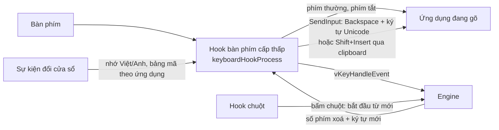

# Tài liệu thiết kế EasyKey

**Tiếng Việt** · [English](DESIGN.en.md)

Tài liệu này giải thích EasyKey hoạt động thế nào và mã nguồn được tổ chức ra sao. Đối tượng là người muốn đọc, sửa hoặc đóng góp mã. Hướng dẫn dùng nằm ở [README](../README.md), cách build ở [BUILD](BUILD.md).

## Mục lục
1. [Mục tiêu](#1-mục-tiêu)
2. [Tổng quan](#2-tổng-quan)
3. [Xử lý một phím](#3-xử-lý-một-phím)
4. [Trạng thái phím bổ trợ](#4-trạng-thái-phím-bổ-trợ)
5. [Giữ hook luôn hoạt động](#5-giữ-hook-luôn-hoạt-động)
6. [Các trường hợp đặc biệt](#6-các-trường-hợp-đặc-biệt)
7. [Engine](#7-engine)
8. [Giao diện](#8-giao-diện)
9. [Lưu cài đặt](#9-lưu-cài-đặt)
10. [Cập nhật](#10-cập-nhật)
11. [Build và phát hành](#11-build-và-phát-hành)
12. [Bản đồ mã nguồn](#12-bản-đồ-mã-nguồn)
13. [Giới hạn đã biết](#13-giới-hạn-đã-biết)

## 1. Mục tiêu
| Mục tiêu | Cách đạt được |
|---|---|
| Một file, không cài đặt | Một `EasyKey.exe` x64, CRT liên kết tĩnh, font và biểu tượng nhúng trong file. Không DLL, không trình cài đặt. |
| Không hiện ô ENG/VIE trên thanh tác vụ | Không đăng ký bàn phím hay dịch vụ TSF với Windows. EasyKey bắt phím bằng hook cấp thấp. |
| Không cần quyền Admin | Mọi thứ nằm trong `HKCU` và thư mục của người dùng. Quyền Admin chỉ dùng khi người dùng bật "Chạy với quyền Admin". |
| Giao diện Windows 11 | Cửa sổ tự vẽ: Mica, sáng/tối theo Windows, màu nhấn, DirectWrite, DPI theo từng màn hình. |
| An toàn khi cập nhật | Chỉ tải qua HTTPS từ trang phát hành, kiểm tra SHA-256, luôn hỏi người dùng. |

## 2. Tổng quan
EasyKey là một ứng dụng Win32 viết bằng C++, gồm hai lớp:

- **Engine** (`Sources/EasyKey/engine`): thuần C++, không gọi Windows API. Nhận từng phím, trả về số ký tự cần xoá và các ký tự mới. Kế thừa từ OpenKey, có test chạy trên cả Windows và Linux.
- **Ứng dụng Windows** (`Sources/EasyKey/win32/EasyKey/EasyKey`): bắt phím, gọi engine, gửi kết quả vào ứng dụng đang gõ, và lo giao diện, cài đặt, cập nhật.



Mọi việc chạy trên luồng chính, nơi có vòng lặp thông điệp. Hook cấp thấp của Windows gọi vào luồng này cho từng phím, nên mọi xử lý trong hook phải nhanh (xem mục 5). Việc chậm như tải bản cập nhật chạy ở luồng riêng.

## 3. Xử lý một phím
EasyKey không chặn trước để "soạn" chữ như bộ gõ TSF. Nó để phím đi vào ứng dụng như bình thường, và khi cần thêm dấu thì xoá chữ cũ rồi gửi chữ mới. Ví dụ gõ Telex `g i u p s`:

| Phím | Engine trả về | EasyKey làm | Màn hình |
|---|---|---|---|
| g, i, u, p | Không làm gì | Cho phím đi tiếp | `giup` |
| s | Xoá 2, gửi `úp` | Chặn phím `s`, gửi 2 Backspace rồi `ú`, `p` | `giúp` |

Chi tiết trong `keyboardHookProcess` (`EasyKey.cpp`):

1. Bỏ qua phím do chính EasyKey gửi (đánh dấu bằng `dwExtraInfo = EASYKEY_EXTRA_INFO`).
2. Bỏ qua nếu ứng dụng đang bật bộ gõ IME (tiếng Nhật, tiếng Trung...).
3. Cập nhật trạng thái phím bổ trợ (mục 4) và kiểm tra phím tắt chuyển Việt/Anh, đổi kiểu gõ, chuyển mã nhanh.
4. Chế độ game và chế độ tiếng Anh: cho phím đi thẳng (tiếng Anh vẫn xử lý gõ tắt nếu được bật).
5. Gọi `vKeyHandleEvent` với mã phím và trạng thái hoa/thường. Kết quả nằm trong `vKeyHookState`: `code` (không làm gì, xử lý, trả lại phím, gõ tắt), `backspaceCount`, `newCharCount`, `charData`.
6. Nếu cần xử lý: gửi Backspace, rồi gửi ký tự mới bằng `SendInput` với `KEYEVENTF_UNICODE` (mặc định), hoặc đặt chữ vào clipboard rồi gửi Shift+Insert (tuỳ chọn "Gửi chữ qua Clipboard"). Phím gốc bị chặn (`return -1`).

Bảng mã cũ (VNI Windows, Unicode tổ hợp) có ký tự dài hai mã, nên EasyKey ghi lại độ dài từng ký tự đã gửi (`_syncKey`) để xoá đúng số Backspace.

## 4. Trạng thái phím bổ trợ
Engine cần biết phím vừa bấm là chữ hoa hay thường, và hook cần biết Ctrl, Alt, Win có đang giữ không để nhận phím tắt. Trạng thái này nằm trong biến `_flag`.

- Khi bấm hoặc nhả Shift, Ctrl, Alt, Win, `SetModifierMask` / `UnsetModifierMask` cập nhật `_flag`. Phím tắt chỉ gồm phím bổ trợ (ví dụ Ctrl + Shift) dựa vào các sự kiện này.
- Trước mỗi phím thường, `syncModifierMask` đọc lại trạng thái thật bằng `GetAsyncKeyState` (Shift, Ctrl, Alt, Win) và `GetKeyState(VK_CAPITAL) & 1` (Caps Lock). Việc này cũng chạy khi khởi động và khi gắn lại hook.

Lý do của bước thứ hai: hook không thấy sự kiện nhả phím xảy ra lúc nó không chạy, ví dụ khi Windows gỡ hook, khi cửa sổ quyền Admin hay màn hình khoá đang ở trước. Trước bản sửa, Shift bị "kẹt" như vậy làm mọi chữ EasyKey gửi lại thành chữ hoa ("giÚP tÔi hOÀN thIỆN"). Hook chạy trước khi phím hiện tại làm thay đổi trạng thái chung, nên với một phím chữ, trạng thái đọc được là chính xác.

## 5. Giữ hook luôn hoạt động
Windows lặng lẽ gỡ hook cấp thấp nếu nó phản hồi chậm hơn `LowLevelHooksTimeout`. Khi đó phím đi thẳng vào ứng dụng và người dùng thấy phím thô ("chaats" thay vì "chất"). EasyKey phát hiện và gắn lại hook bằng hai cách:

- **Raw input** (`onRawKeyboard`): EasyKey nhận thêm mọi phím từ bàn phím thật qua `RegisterRawInputDevices` với `RIDEV_INPUTSINK`. Windows gọi hook trước khi tạo raw input, nên nếu raw input đếm được nhiều phím hơn hook thì hook đã mất.
- **Hẹn giờ 2 giây** (`checkHooks`): nếu Windows có input mới mà cả hai hook không chạy trong hơn 1 giây, gắn lại.

Cả hai bỏ qua khi cửa sổ đang ở trước chạy quyền Admin, vì lúc đó hook không thấy phím là bình thường. Để hook nhanh, mọi lời gọi có thể chờ (ví dụ hỏi trạng thái IME) đều có thời hạn ngắn (`SendMessageTimeout`, 50 ms).

## 6. Các trường hợp đặc biệt
| Trường hợp | Cách xử lý | Ở đâu |
|---|---|---|
| Ô có gợi ý tự động (thanh địa chỉ trình duyệt) | Chrome, Edge, Brave: chọn ký tự cuối bằng Shift+Left để Backspace xoá luôn phần gợi ý. Ứng dụng khác: gửi một ký tự trống (U+202F) rồi xoá thêm một lần. | `keyboardHookProcess`, `_chromiumBrowser` |
| Ứng dụng quyền Admin | Windows không cho ứng dụng thường gửi phím vào. EasyKey báo một lần cho mỗi ứng dụng. Tuỳ chọn chạy quyền Admin dùng Task Scheduler để khởi động cùng Windows mà không hỏi UAC. | `onElevatedWindow`, `registerAdminTask` |
| Phím tắt có Alt hoặc Win | Hook ăn mất phím chữ của phím tắt, nên ứng dụng tưởng Alt/Win được bấm riêng và mở menu hay Start. EasyKey gửi thêm phím trống 0xE8 để tránh việc này. | `maskMenuKey` |
| Chế độ game | Với game trong danh sách, phím đi thẳng vào game. Enter mở chat thì bỏ dấu, Enter hoặc Esc kết thúc. | `_inGame`, `_gameChat` |
| Nhớ theo ứng dụng | Khi đổi cửa sổ (`EVENT_SYSTEM_FOREGROUND`), đọc lại Việt/Anh và bảng mã đã lưu cho file exe đó. | `winEventProcCallback`, `SmartSwitchKey.cpp` |
| Bấm chuột | Bắt đầu từ mới, vì con trỏ có thể đã sang chỗ khác. | `mouseHookProcess` |

## 7. Engine
| File | Nội dung |
|---|---|
| `Engine.cpp/.h` | Điểm vào `vKeyHandleEvent`, bộ đệm từ đang gõ, quy tắc Telex/VNI/Simple Telex, kiểm tra chính tả, trả lại phím, gõ nhanh. Các tuỳ chọn là biến toàn cục `v...` do ứng dụng đặt. |
| `Vietnamese.cpp/.h` | Bảng nguyên âm, phụ âm, vị trí dấu và bảng ký tự cho từng bảng mã. |
| `Macro.cpp/.h` | Gõ tắt: lưu, tìm, đọc/ghi dạng nhị phân. |
| `SmartSwitchKey.cpp/.h` | Bảng nhớ Việt/Anh và bảng mã theo tên ứng dụng. |
| `MixedWords.cpp/.h`, `MixedWordsData.h` | Danh sách từ cho chế độ Anh–Việt (xem dưới). `MixedWordsData.h` sinh bằng `tools/make_mixed_words.py`. |
| `ConvertTool.cpp/.h` | Chuyển văn bản giữa các bảng mã, đổi hoa/thường, bỏ dấu. |
| `DataType.h` | `vKeyHookState` và các hằng số chung. |

Test engine ở `Sources/EasyKey/tests/EngineTests.cpp` (Telex, VNI, chuyển mã, Anh–Việt). Khi sửa engine, thêm ca test cho lỗi vừa sửa.

**Chế độ Anh–Việt** (`vMixedEnglish`, chỉ có tác dụng khi `vLanguage` = 1). Engine vẫn bỏ dấu như thường trong lúc gõ. Khi từ kết thúc (dấu cách, dấu câu), `checkMixedEnglish` tra các phím đã gõ (cả phím gõ đôi để bỏ dấu, như "ff" trong "different") trong danh sách khoảng 3.300 từ: mỗi từ có độ phổ biến (Zipf × 10) trong tiếng Anh và của chữ Việt mà Telex tạo ra từ cùng các phím. Từ được coi là tiếng Anh khi điểm Anh − điểm Việt − 5 (nghiêng về tiếng Việt) cộng độ lệch ngữ cảnh (tối đa ±20, theo ngôn ngữ các từ vừa gõ) lớn hơn 0; khi đó engine xoá chữ Việt và gửi lại phím gốc. Từ có dấu không nằm trong danh sách được tính là tiếng Việt. Một từ rõ ràng (chênh từ 20 điểm) còn sửa lại từ ngay trước nó nếu hai từ chỉ cách nhau một dấu cách: "Thể are" thành "There are", "The cả was" thành "The car was" (không làm với VNI Windows và Unicode tổ hợp vì số phím xoá không chắc chắn). Danh sách lấy từ dữ liệu [wordfreq](https://github.com/rspeer/wordfreq) (CC BY-SA 4.0); muốn đổi ngưỡng thì sửa đồng thời `Engine.cpp` và `tools/make_mixed_words.py`, rồi chạy lại script.

## 8. Giao diện
Giao diện không dùng hộp thoại Win32 cổ điển mà tự vẽ để giống Windows 11:

| File | Vai trò |
|---|---|
| `FluentWindow` | Lớp nền cho cửa sổ: Mica, thanh tiêu đề tối/sáng, DPI theo màn hình, vẽ nút, công tắc, ô chọn. |
| `FluentText` | Vẽ chữ bằng DirectWrite (nét mịn ở mọi mức phóng to), font Be Vietnam Pro nhúng trong exe. |
| `FluentUi` | Màu, bo góc, kích thước dùng chung. |
| `ThemeHelper` | Đọc chế độ sáng/tối và màu nhấn của Windows, bảng màu nhấn có sẵn, tính tương phản. |
| `SettingsWindow` | Cửa sổ Cài đặt: màn hình chính và phần Nâng cao (danh sách mục khai báo ở đầu file). |
| `FlyoutWindow` | Popup nhỏ khi chuyển Việt/Anh và các thông báo, vẽ bằng Direct2D. |
| `MessageWindow` | Hộp thoại hỏi/thông báo cùng phong cách. |
| `SystemTrayHelper`, `TrayGlyph` | Biểu tượng khay (vẽ đúng cỡ pixel theo DPI) và menu chuột phải. |
| `AboutWindow`, `MacroWindow`, `ConvertToolWindow` | Giới thiệu, Bảng gõ tắt, Công cụ chuyển mã. |

Chữ trên giao diện có hai ngôn ngữ, chọn bằng macro `TR("tiếng Việt", "English")` hoặc cặp `_T()` trong bảng mục của `SettingsWindow`.

## 9. Lưu cài đặt
- Mọi cài đặt nằm trong `HKCU\Software\EasyKey`. Mỗi tuỳ chọn là một giá trị `REG_DWORD` cùng tên biến (ví dụ `vInputType`, `vCodeTable`, `vSwitchKeyStatus`), đọc bằng `APP_GET_DATA` và ghi bằng `APP_SET_DATA`.
- Dữ liệu lớn lưu dạng nhị phân: `macroData` (bảng gõ tắt), `smartSwitchKey` (nhớ theo ứng dụng), `gameApps` (tên exe các game, mỗi dòng một tên).
- Lần đầu chạy, nếu có `HKCU\Software\TuyenMai\OpenKey`, EasyKey chép sang.
- Chạy cùng Windows: giá trị `EasyKey` trong `HKCU\...\CurrentVersion\Run`, hoặc một tác vụ Task Scheduler khi bật chạy quyền Admin.
- "Gỡ EasyKey khỏi Windows" xoá khoá `HKCU\Software\EasyKey`, mục chạy cùng Windows và lối tắt.

## 10. Cập nhật
Cập nhật nằm trong `Updater.cpp`, chạy ở luồng riêng để không làm khựng bàn phím và chuột:

1. Đọc `version.json` trên nhánh `master` (`latestWinVersion.versionName`) và so với phiên bản đang chạy. Kiểm tra lúc khởi động và 6 giờ một lần nếu bật tự kiểm tra.
2. Khi người dùng đồng ý, tải `EasyKey.exe` và `EasyKey.exe.sha256` từ `releases/download/<phiên bản>/`. Từ chối nếu mã SHA-256 không khớp hoặc file không bắt đầu bằng `MZ`.
3. Ghi `EasyKey.new.exe`, đổi tên file đang chạy thành `EasyKey.old.exe` (Windows cho đổi tên nhưng không cho ghi đè exe đang chạy), rồi đổi tên file mới thành `EasyKey.exe`. Lỗi ở bước nào thì trả lại như cũ.
4. Gỡ hook, chạy bản mới với tham số cập nhật rồi thoát. Bản mới chờ bản cũ thoát hẳn và xoá `EasyKey.old.exe`.

## 11. Build và phát hành
- Dự án Visual Studio 2022 (toolset v143), chỉ cấu hình `Release|x64` được phát hành. Chi tiết ở [BUILD](BUILD.md).
- CI (`.github/workflows/msbuild.yml`): chạy test engine trên Windows và Linux, build x64, tải exe lên mục Artifacts và tạo chứng thực nguồn gốc.
- Phát hành: cập nhật `versionName` và `versionCode` trong `version.json` và thêm mục vào hai file CHANGELOG, merge vào `master`, rồi chạy tay workflow MSBuild (Actions › MSBuild › Run workflow). Workflow tạo tag trùng `versionName`, build, tạo `EasyKey.exe`, `EasyKey.exe.sha256`, `EasyKey<phiên bản>-Windows.zip`, chứng thực và trang phát hành có ghi chú lấy từ CHANGELOG.
- Bản đang chạy cũng đọc `version.json` trên `master`, nên chỉ đổi phiên bản trong file này khi bản phát hành tương ứng sắp có.

## 12. Bản đồ mã nguồn
```
Sources/EasyKey/
├── engine/                 engine gõ tiếng Việt (C++ thuần, dùng chung)
├── tests/                  test engine (CMake)
└── win32/EasyKey/
    ├── EasyKey.sln
    └── EasyKey/
        ├── main.cpp            điểm vào, tự chạy lại với quyền Admin nếu được bật
        ├── AppDelegate         vòng đời ứng dụng, hẹn giờ, lần chạy đầu, thông báo
        ├── EasyKey.cpp         hook bàn phím/chuột, gửi phím, theo dõi hook
        ├── EasyKeyManager      bật/tắt engine
        ├── EasyKeyHelper       registry, chạy cùng Windows, đường dẫn, clipboard
        ├── Updater             tự cập nhật
        ├── *Window, Fluent*    giao diện (mục 8)
        └── fonts/              Be Vietnam Pro (nhúng vào exe)
docs/                       tài liệu và ảnh chụp
tools/                      script tạo biểu tượng, font và danh sách từ Anh–Việt
version.json                phiên bản mới nhất, bản đang chạy đọc để biết có cập nhật
```

Giấy phép: toàn bộ dự án là GPL-3.0. Các file giao diện viết mới (`Fluent*`, `FlyoutWindow`, `MessageWindow`, `ThemeHelper`, `TrayGlyph`, `Updater`) được cấp thêm MIT, ghi ở dòng `SPDX-License-Identifier` đầu mỗi file.

## 13. Giới hạn đã biết
- **Hook thay vì TSF.** Cách xoá rồi gửi lại có thể lộ ra với ứng dụng tự theo dõi từng phím (trang luyện gõ, một số game). Bù lại không có ô ENG/VIE trên thanh tác vụ. TSF được để dành cho một sản phẩm riêng sau này.
- **Ứng dụng quyền Admin** chỉ gõ được khi EasyKey cũng chạy quyền Admin.
- **Chưa có chữ ký số**, nên SmartScreen và phần mềm diệt virus có thể cảnh báo.
- **Chỉ Windows x64.** Không có bản x86, ARM64, macOS hay Linux.
